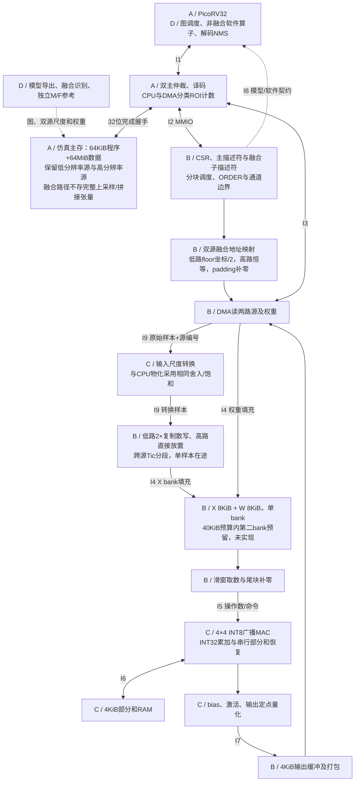

# 面向轻量目标检测的多尺度特征融合与卷积协同加速架构

本文件保留总体设计、研究目标和四人八周验收约定（32人周）。目标检测实现已落地，实际模块、接口选择与测量边界见 [implementation.md](implementation.md)，已实现接口见 [interfaces.md](interfaces.md)，实测见 [结果汇总](../results/summary.md)。本文件中的双bank等扩展和阈值目标不自动等于已经达成；本报告仅使用检测性能。

## 1. 目标与研究问题

题目：**面向轻量目标检测网络的多尺度特征融合与卷积协同加速架构**。

应用为单帧图像中的多类别目标检测，batch=1。核心问题是：在固定 4×4 INT8 MAC 阵列、32 位共享存储接口和 40 KiB 加速器本地缓冲预算下，怎样将“两倍最近邻上采样 → 通道拼接 → 卷积”融合执行，省去上采样与拼接中间张量的主存写入和重读，并降低整网周期？卷积分块与片上复用作为支撑设计。

硬件接受卷积描述符，不包含模型名称、固定网络层号或写死的层间连接。模型图由 CPU 调度。以一个模型优化，以第二个模型验证可迁移性；第二个模型只能更换权重、图、量化参数及描述符，不改 RTL。

最低交付是可复现 RTL 仿真、真实 RISC-V 固件执行、两模型完整检测输出、独立参考和通用逻辑综合。本阶段不包含 FPGA 板卡、摄像头、DDR 控制器、物理设计和实际功耗测量；图像由测试平台装入内存。

## 2. 模型和算子边界

| 项目 | 主验证 | 可迁移性验证 |
|---|---|---|
| 模型 | YOLOv3-tiny | YOLOv4-tiny |
| 输入 | 160×160 RGB，batch=1 | 160×160 RGB，batch=1 |
| 权重 | 官方项目公开预训练权重，保留类别和 anchors | 对应模型公开预训练权重，保留自身解码配置 |
| 图结构 | 完整双尺度检测输出 | 完整双尺度输出，覆盖通道切片和拼接 |
| 硬件 | 全部支持范围内的普通卷积 | 使用同一 RTL 和寄存器协议 |
| 融合路径 | 双尺度连接处的上采样+拼接+后续卷积 | 同类双尺度连接使用同一融合描述符与RTL |
| 软件 | 池化、非融合route/concat、解码、NMS；保留上采样/拼接基线 | 另覆盖 route 的 groups/group_id 语义；骨干内部拼接仍由CPU处理 |

160×160 是本项目为控制仿真时间选择的实验配置，不是原模型的 416×416 默认配置。浮点与定点必须采用同样分辨率、letterbox、类别、anchors、置信度阈值和 NMS 参数。模型导出器从各自配置读取检测头的 mask、scale_x_y 等参数，禁止共用一套未经核对的解码公式。缩小分辨率的准确率影响单列，不与量化误差混为一谈。

官方配置来源（2026-10-28 查阅）：[YOLOv3-tiny](https://github.com/pjreddie/darknet/blob/master/cfg/yolov3-tiny.cfg)、[YOLOv4-tiny](https://github.com/AlexeyAB/darknet/blob/master/cfg/yolov4-tiny.cfg)。两者含 1×1/3×3 卷积、leaky/linear 激活和双尺度输出；v4-tiny 还有分组 route。第 1 周将配置、权重、参考实现固定到提交与 SHA256；当前链接是来源，不是已固定版本。旧模型便于限制算子范围，本项目不以检测准确率领先为目标。

| 能力 | 硬件范围或软件实现 |
|---|---|
| Conv2D | 普通 groups=1，kernel=1/3，stride=1/2，dilation=1，四侧 padding 各为 0/1 |
| 尺寸 | H/W=1～160，Cin/Cout=1～1024；由分块循环支持，不要求片上容纳整层 |
| 数值 | 输入/权重有符号 INT8、零点 0，INT32 累加与 bias，按输出通道定点缩放 |
| 激活 | linear、ReLU、LeakyReLU；斜率用约定定点乘移实现 |
| BN | 导出时折叠到卷积权重与 bias，无运行时 BN 模块 |
| 池化 | CPU；包括 size=2、stride=1 的边界规则，不能假定所有池化均减半 |
| 融合输入 | 两路NHWC：一路低分辨率特征2×最近邻上采样，与同尺寸高分辨率特征按通道拼接，直接供卷积取数 |
| route/slice/concat | CPU 管理生命周期；非融合拼接显式拷贝，必要时统一量化尺度；不连续slice物化 |
| 上采样/图像前处理 | 融合路径由硬件坐标映射实现；其他上采样和letterbox由CPU处理，CPU上采样保留作等价基线 |
| 解码/NMS | CPU；浮点或定点实现均须固定算法，与参考对照 |
| 不支持 | depthwise/group convolution、attention、任意 ONNX 图、训练、动态 batch |

不支持的图在导出阶段明确报错，不静默套用其他算子。只在上述已声明的软件算子上使用 CPU 回退；不得用 CPU 卷积代替第二模型的硬件可迁移性验收。

## 3. 架构与复用边界

框图见 [architecture.svg](architecture.svg)，可编辑源见 [architecture.mmd](architecture.mmd) 与 [architecture.dot](architecture.dot)。接口详见 [interfaces.md](interfaces.md)，人员安排见 [schedule.md](schedule.md)。

| 现有模块 | 处理方式 | 必须新增或修改 |
|---|---|---|
| PicoRV32、启动和原生互连 | 复用 | 新地址边界、链接脚本、64MiB模型内存、软件检测输出 |
| conv_core.sv | 当前4×4广播MAC阵列 | 部分和恢复、串行导出、定点后处理 |
| det_accelerator.sv | 检测调度和融合控制 | 双源地址映射、分块、存储和错误检查 |
| 检测 CSR 与固件 | 版本0x00020100 | MMIO、主/融合描述符与检测图运行时 |
| 单项读缓存 | 保留为基线策略 | 双源融合地址生成、分支重定标、本地分块缓冲；双bank作为进度允许时扩展 |
| NumPy / BFM / 回归脚本 | 复用方法 | 独立卷积参考、图执行器、两模型向量和性能汇总 |

模块目录：rtl/、firmware/、spec/、tb/、scripts/、data/、results/。每个模块的唯一主责和接口评审人见接口文档，避免多人同时改同一大 FSM。

## 4. 数据流和容量预算

主存激活使用连续 NHWC INT8；卷积权重导出为 OHWI INT8，即 W[oc,kh,kw,ic]。N=1。层内定义 M=Hout×Wout、N=Cout、K=Kh×Kw×Cin，将四个输出空间位置映射到阵列四行，四个输出通道映射到四列。滑窗单元直接生成阵列操作数，不向主存写入完整 im2col。

先做单 bank 正确版本及融合，再按进度启用双 bank。默认候选块 Th=8、Tw=8、Tic=16、Toc=16，小层和尾块缩小；软件枚举合法块并用统一规则选择，RTL检查容量。1×1 可尝试更大空间块，但不能突破下述约束。

| 本地缓冲 | 大小 | 端口/使用规则 |
|---|---:|---|
| 输入 X | 2×8KiB | 每 bank 同步单端口；DMA填备用 bank，取数读活动 bank |
| 权重 W | 2×8KiB | 每 bank 同步单端口，同上 |
| 部分和 P | 4KiB | 存 Th×Tw×Toc 个 INT32；先串行恢复/写回，避免端口冲突 |
| 输出 O | 4KiB | 同步单端口；分阶段填充/排空，不宣称同时读写 |
| 合计 | 40KiB | 不含少量 FIFO、CSR、16个PE累加器；须分别统计这些开销 |

约束：X=( (Th−1)×stride+Kh )×( (Tw−1)×stride+Kw )×Tic ≤8192；W=Kh×Kw×Tic×Toc≤8192；P=Th×Tw×Toc×4≤4096；O=Th×Tw×Toc≤4096。最坏候选 8×8、stride2、3×3、Tic16 对应 X=4624B、W=2304B、P=4096B，均合法。边界 halo 计入 X，不将其当成免费数据。

基础循环：空间块 → 输出通道块 → 输入通道块 → 4空间×4输出通道微块 → K四元素片段。每个输入通道块只填一次 X/W，随后遍历其所有微块；相邻空间块的 halo 初版允许重复读取。输出通道块变化后初版允许重新读取 X，后续优化必须单列。

输入通道块切换时，一个微块的部分和必须存入 P；重新访问该微块时从 P 恢复16个INT32。不能只依赖16个PE寄存器保存整个8×8×16块。第一输入块以0初始化，最后输入块才进行 bias/激活/量化。恢复与保存开销计入周期；旧核心的10拍计算只是K=4的一次片段计算，不等同新任务时延。

双bank物理容量预留；单bank融合是必须交付，双bank重叠是扩展实验，不作为融合验收前提。双缓冲只重叠“下一输入通道块的 X/W DMA”和“当前块的取数/计算”；受同一外部总线带宽限制，不承诺访存与计算完全隐藏。现有核心装载/计算可先保持串行，不能据双 bank 推断其已支持每拍连续输入。

### 4.1 检测专用路径：虚拟上采样与拼接

融合只覆盖“一路2×最近邻上采样 + 一路同分辨率特征 + 通道拼接 + 一层普通卷积”。不实现任意图融合，不融合骨干内部所有route；网络其他层沿用普通卷积和CPU算子。支持切换两路拼接顺序，必须保持权重Cin顺序不变，不能把源通道重排而不更新卷积语义。

融合输入是一个虚拟NHWC张量，其H/W等于高分辨率分支，Cin=C0+C1。对卷积请求的逻辑坐标(y,x,c)：先做卷积padding检查，越界直接返回整数0，不读源；再按拼接顺序确定源j及局部通道cj。低路坐标为(floor(y/2),floor(x/2))，高路为(y,x)，地址为SRCj+((yj*Wj+xj)*Cj+cj)。源尺寸必须满足H0*2=H1=H、W0*2=W1=W。两路均连续NHWC，零点0；不支持任意插值或裁剪。

B按源像素读入，C通过I9转换 `v=clip(round_away(q*m_j/2^s_j),−127,127)`，其中m_j近似源尺度/虚拟输入尺度，m_j为非负31位、s_j=0..62。转换在复制之前发生，B将低路转换结果散写到当前X块内对应的最多2×2个位置；低路原始像素在同一填块范围内复用。不能声称跨空间块/输出通道块只读一次。卷积padding值不参与尺度转换。

X仍保存展开后的虚拟输入块，容量公式保持不变；只消除主存中间张量，不消除本地展开。两路源按通道区间轮流填充同一X bank，不各分配一个8KiB bank。一个Tic块跨越C0/C1边界时分成两段填充，bank只有两段以及padding均完成后才READY；通道尾块明确补零。输入转换使用最多16×32bit暂存FIFO（64B），单独列入SRAM预算外的小FIFO开销，不新增整层/整块隐藏缓冲。

M与F的整数语义完全相同：低路先转换再2×复制，高路转换后按原顺序拼接，最终再做卷积。融合共同输入尺度来自同一校准元数据；不得把比例因子折叠进权重来跳过中间舍入/饱和，否则无法保证逐元素相同。

## 5. 数值与内存设计

采用静态后训练量化，校准数据与评价数据分离。权重按输出通道缩放，激活按张量缩放，均为零点0。导出器保留每个张量尺度；concat分支若尺度不同，物化基线由CPU重定标；融合路径由C的输入转换器按同一整数公式转换到共同尺度，slice视图保持原尺度。特征不能仅因都是INT8就直接拼接。

累加 a=sum(x*w)，t=a+bias[oc]。a 的绝对值在 K≤9216 时不超过 150994944，INT32点积足够；a+bias 仍必须导出时验证范围。激活用双参数定点映射：t≥0 时使用 (m_pos,s_pos)，t<0 时使用 (m_neg,s_neg)，均为每输出通道参数。linear 两组相同，ReLU负支 m_neg=0，leaky负支包含斜率与输出尺度。输出 y=clip(round_away(t*m_branch/2^s_branch),−127,127)。m是非负31位整数、s=0～62；乘法和绝对值舍入用有符号64位/等价扩位逻辑。第一版允许多周期共享乘法器。最终检测头同样写INT8，CPU按记录尺度反量化再解码。不能用最终框“差不多”替代逐元素对拍。

原 256KiB 不能容纳这些完整权重。新增主存模型：0x00000000～0x0000FFFF 程序64KiB；0x01000000～0x04FFFFFF 为64MiB可读写数据区；数据区按偏移映射仿真数组，不按最大地址申请巨大空洞。权重、活动图、保留分支、参数、输入、CPU工作区均由静态内存规划分配，输出导出地址表、峰值存活字节和链接图。若固件超过64KiB，先收缩库和打印；扩大程序区必须更新同一地址规范。

DMA仅可访问新数据区，栈/固件工作区由软件规划器保护。模型参数和输入在START到DONE期间只读，输出不得和任何读区重叠；禁止原地卷积。CPU完成前不访问由加速器独占的可写区域。仿真SRAM的容量不代表芯片片上SRAM面积，40KiB本地缓冲与64MiB仿真主存分开报告。

两个模型分次装载和运行，不要求同时常驻64MiB。第1周分别生成完整存活期内存预算，分别计算物化/融合两种执行图的峰值，包含软件临时拷贝和保留分支。融合路径不得分配完整上采样或拼接张量，但两个源特征仍需常驻到融合卷积结束，不能只统计省掉的张量。

CPU池化必须遵循所选参考实现的边界语义：越界位置按负无穷等效值处理，不可照搬卷积的补零。NMS固定类别处理方式、IoU阈值、最大框数及同分排序规则，避免后处理差异掩盖硬件数值问题。

## 6. 验收与实验

| 层次 | 必须交付的证据 |
|---|---|
| 融合 | 至少50组双源随机子图：通道边界落在Tic内部、两种拼接顺序、负值/饱和、不同尺度、奇数空间块起点、halo/补零；与CPU先转换再上采样拼接卷积逐元素相同；禁止向U/C虚拟张量主存写入 |
| 算子 | 至少100组固定种子随机卷积；1×1/3×3、stride1/2、padding、Cin/Cout非4/16倍数、输入通道跨块、空间尾块；全部逐元素匹配独立INT64参考 |
| 协议 | 随机存储等待、结果背压、双bank所有权、部分和恢复、busy配置拒绝、非法地址/容量、复位中断后重跑；断言稳定性与watchdog |
| 模型 | 两模型均先通过主机定点整图执行；RTL真实CPU至少各1张完整图，全层硬件卷积且层输出与定点参考一致；各模型另外保留10张主机检测可视化 |
| 精度 | 固定COCO val2017的500张清单，报告AP@[.5:.95]和AP50；独立校准100张train2017，不与评价重叠；固定预处理与评估脚本版本 |
| 精度目标 | 同160输入下，相对浮点参考的AP下降目标≤3个百分点；若不满足，报告实际结果并完成量化定位，不能标为精度达标 |
| 性能 | 每模型至少各1张完整RTL测量，逐层采集周期/事务/计算使能/等待；固定图像ID、配置和模型哈希 |
| 资源 | 物化卷积M、融合F、可选双bank各配置的逻辑统计；缓冲bit数独立列示；说明RAM映射策略 |
| 复现 | 一条命令小回归、一条命令完整检测回归、一条命令精度评估；依赖版本、模型来源、日志、失败退出码和结果表 |

500张用于精度实验，不要求逐张RTL仿真。主机定点图只能提供精度证据；完整RTL样本提供集成/周期证据，不能相互替代。第2周测量仿真速度并预算单图墙钟时间，长回归可夜间运行；不得用主机算子替身产生的周期声称真实CPU整网加速。

核心对照采用相同阵列、相同分块、相同40KiB SRAM预算：B0=CPU同一定点图；M=CPU整数重定标/上采样/拼接物化 + 硬件分块卷积；F=双源地址映射 + 硬件输入重定标 + 同一硬件分块卷积。M/F均使用单bank调度，保证逐元素相同。主模型至少B0/M/F各1张完整RTL，第二模型至少M/F各1张完整RTL；可额外提供第二模型B0。每个模型至少覆盖1处真实融合子图，不能用骨干内普通卷积替代融合验证。

普通卷积的直接取数/单bank复用对照只做代表层实验；双bank重叠为扩展项，不能挤占两模型融合验收。主要收益指标是融合子图全部CPU与DMA主存读写字节、总线读写事务、峰值主存分配、子图周期及整网周期。现有DMA计数看不到CPU物化开销，A须在内存端增加按CPU/DMA和读/写分类的计数，支持固件ROI边界，包含CPU栈/参数访存并明确口径；按接口3.1区分CPU数据、取指与DMA，并另列张量逻辑流量以解释开销。

设上采样后低路张量U字节，高路V字节，拼接张量C=U+V。逻辑流量拆分：物化的上采样读低路、写U；拼接读U+V、写C；卷积再读取C（可能多次）。融合只读取两路源并在片上转换/展开，省去U、C的主存写入及其消费阶段的中间读取；但源跨块重读、32位对齐、尺度转换、halo、输出通道块重访仍存在，不能直接把逻辑节省换成总线字数或整网加速比。

必须达成的结构目标：F不在主存分配/写入完整U与C，所有融合卷积结果与M逐元素相同。性能研究目标：相对M，融合子图总主存读写字节降低≥30%、子图周期降低≥15%；这两个数字为待测目标。M/F差异包含尺度转换的硬件卸载，需另列输入转换周期与资源；补做两路等尺度（m=1,s=0）的代表子图M/F实验，区分数据物化消除与转换卸载的收益。报告所有选定融合子图及整网结果，未达标保留负结果与瓶颈解释，工程正确性和性能目标分别标记。

计时拆分：预处理、网络（含CPU算子/驱动/轮询/争用）、解码NMS，以及三者之和。磁盘读取、模型装载和可视化在计时外。整网speedup采用完整网络口径，并另列端到端口径；反映CPU软件算子占比。没有时序收敛依据，不将仿真周期换算成真实FPS，不报告实测功耗。

## 7. 执行规则

详细32人周安排见 schedule.md。第1周冻结模型/布局/数值/接口；第2周提交可工作的替身与主机图；第4周普通卷积与融合小子图；第6周主模型完整融合检测；第7周第二模型同RTL；第8周消融和交付。每周保留可复现里程碑，任何范围变化更新接口版本与验收表。

不增加深度卷积、AXI、摄像头或Transformer来填工作量。若进度落后，先取消双bank重叠、额外阵列尺寸扫描和更高分辨率实验，保留两模型融合、数值正确性、完整检测和M/F基线对照。实际实现与真实贡献由成员逐周登记，不能把这份分工当作已完成记录。
