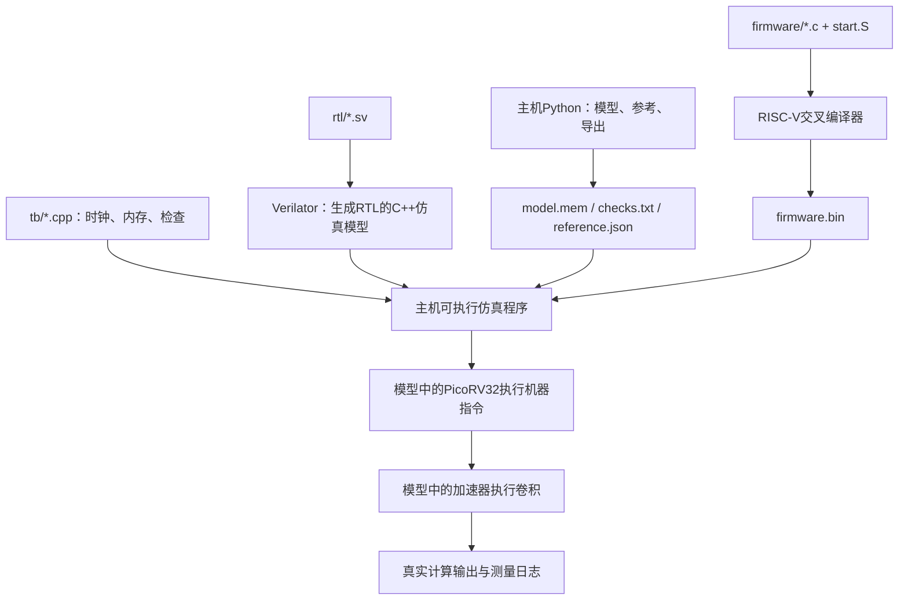

# 从零学习这个项目：阅读路线、设计原理与动手练习

这份指南面向第一次接触“CPU + 自研硬件加速器 + 神经网络推理”的读者。你不需要先理解整个YOLO，也不需要先读完CPU源码。我们从一次小计算开始，逐步把算法、数据布局、硬件时序、驱动和完整模型连起来。

本文解释的是仓库**当前实际实现**。接口字段以 [interfaces.md](interfaces.md) 和 [registers.json](../spec/registers.json) 为准；模块边界见 [implementation.md](implementation.md)。[design.md](design.md) 还包含研究目标与扩展设想，读它时要与当前实现区分。

文中的终端命令，除非特别说明，都在项目根目录 `ai-soc/` 中执行。首次安装依赖按 [README](../README.md) 操作。`build/` 是运行脚本后生成的目录，刚clone时看不到是正常的。

## 导航

1. [先认识最终要学会什么](#先认识最终要学会什么)
2. [阅读路线与每一站的过关问题](#阅读路线与每一站的过关问题)
3. [三个执行世界与工具链](#三个执行世界与工具链)
4. [第一次运行与结果阅读](#第一次运行与结果阅读)
5. [卷积、矩阵映射与数据布局](#卷积矩阵映射与数据布局)
6. [为什么需要分块和四类缓冲](#为什么需要分块和四类缓冲)
7. [项目核心：多尺度特征融合](#项目核心多尺度特征融合)
8. [INT8与定点数值如何保持一致](#int8与定点数值如何保持一致)
9. [读懂最小计算核心](#读懂最小计算核心)
10. [CPU如何启动硬件](#cpu如何启动硬件)
11. [沿状态机走完一次卷积](#沿状态机走完一次卷积)
12. [模型如何变成固件可执行的图](#模型如何变成固件可执行的图)
13. [验证体系与调试方法](#验证体系与调试方法)
14. [如何解释性能、精度和综合结果](#如何解释性能精度和综合结果)
15. [分阶段动手练习](#分阶段动手练习)
16. [术语、自检答案与后续方向](#术语自检答案与后续方向)

## 先认识最终要学会什么

整个项目可以用下面这句话描述：

> Python把检测模型整理成整数权重、数据和任务描述；RISC-V运行C程序，逐层调度；遇到卷积时启动自研RTL；RTL自行取数、计算和写回；CPU继续运行其他算子，最后输出检测框。

其中最有针对性的设计，是把检测网络中的“低分辨率特征上采样、与高分辨率特征拼接、接着卷积”合并到硬件取数过程中。

学习完成后，你应该能独立回答：

- 一幅图像的数据怎样从文件进入仿真内存，最后变成检测框？
- CPU发给加速器的究竟是数据、程序，还是一份配置？
- 一个输出像素为什么需要这么多乘加？4×4阵列的16个累加器各算什么？
- 片上缓冲放不下完整模型时，部分和如何跨多个输入通道块保存？
- 为什么两路INT8数据不能仅因类型相同就直接拼接？
- F模式省掉了什么，哪些搬运仍然存在？
- 测试通过、检测精度达标和加速效果好，分别靠什么证据？

这些问题比背下所有信号名更重要。每读一个模块，先写下四件事：**输入是什么、输出是什么、保存了什么状态、什么时候算完成**。

### 当前项目的真实范围

| 内容 | 当前情况 |
|---|---|
| 两个检测模型 | YOLOv3-tiny、YOLOv4-tiny；同一份RTL，通过图和描述符配置 |
| 输入 | 160×160、batch=1；主机完成图像前处理 |
| 硬件计算 | 普通1×1/3×3卷积、输入尺度转换、输出偏置/激活/量化 |
| CPU计算 | 池化、部分拼接/切片/上采样、图调度、检测框解码与NMS |
| 核心 | 4×4广播MAC阵列，INT8乘法、INT32累加 |
| 本地scratch存储 | X/W各8KiB，P/O各4KiB，共24KiB；40KiB是设计预算 |
| 数据主存 | 测试平台提供64MiB模型数据区，不是64MiB已实现片上SRAM宏 |
| 执行环境 | Verilator仿真；PicoRV32真的执行编译后的RISC-V指令 |
| 尚未完成的扩展 | 双bank重叠、真实FPGA、物理设计和实际功耗/频率测量 |

“单bank”表示输入/权重缓冲尚未做两份交替使用，当前搬运与计算主要串行。知道这个范围，可以避免把目标方案中的能力误认为已经存在。

## 阅读路线与每一站的过关问题

建议按“先理解一个数怎样算，再理解一次任务怎样运行，最后理解一个模型怎样执行”的顺序。下面各站不要求同一天完成；基础不熟时，停下来做手算和小实验更有价值。

| 顺序 | 主要阅读文件 | 这次只抓住什么 | 过关标准 |
|---|---|---|---|
| 1 | 本文前三节、[README](../README.md)、[框图](architecture.svg) | 项目分成哪些执行部分，当前能运行什么 | 能用自己的话画出Python→内存→CPU→加速器→CPU的路径 |
| 2 | [run_all.sh](../scripts/run_all.sh) | quick/full/accuracy分别验证什么 | 能运行quick，并指出每类PASS的含义 |
| 3 | [reference.py](../scripts/reference.py) | 普通卷积、定点舍入、物化融合的数学结果 | 手算一个小卷积，再用NumPy对上 |
| 4 | [conv_core.sv](../rtl/conv_core.sv) | 4个A与4个B如何广播，16个acc如何更新 | 能算出两次step后的任一acc |
| 5 | [requant.sv](../rtl/requant.sv)、[fuse_requant.sv](../rtl/fuse_requant.sv) | 位宽、负数舍入、饱和、valid/ready | 能解释-1除以2为何输出-1，以及背压时保存什么 |
| 6 | [driver.c](../firmware/driver.c)、[driver.h](../firmware/driver.h)、[接口文档](interfaces.md) | 软件怎样配置任务、启动、等完成 | 能从det_conv追到DESC_ADDR、CTRL、STATUS |
| 7 | [det_soc_top.sv](../rtl/det_soc_top.sv)、[native_arbiter.sv](../rtl/native_arbiter.sv) | CPU/DMA共享内存、MMIO译码、事务完成 | 能解释为什么等待期间不能切换总线主人 |
| 8 | [det_accelerator.sv](../rtl/det_accelerator.sv) | 按本文状态分组读，先普通卷积，再融合取数 | 能沿状态机走完一个跨Cin块任务 |
| 9 | [gen_vectors.py](../scripts/gen_vectors.py)、[accelerator.cpp](../tb/accelerator.cpp) | 参考、激励、内存、错误注入怎样分工 | 能添加一个小形状并定位第一个错误字节 |
| 10 | [export_model.py](../scripts/export_model.py)、[memory.py](../scripts/memory.py) | 模型图怎样变成地址、描述符和操作记录 | 能在manifest中找到某层的地址、形状与参考文件 |
| 11 | [main.c](../firmware/main.c)、[soc.cpp](../tb/soc.cpp)、[memory.hpp](../tb/memory.hpp) | CPU执行整图与测试平台怎样配合 | 能区分固件计算与测试平台事后检查 |
| 12 | [model.py](../scripts/model.py)、[postprocess.c](../firmware/postprocess.c)、[evaluate.py](../scripts/evaluate.py) | 模型导入、量化尺度、检测框与AP | 能说明整数层对拍与检测精度评价的区别 |
| 13 | [结果汇总](../results/summary.md)、[synth.sh](../scripts/synth.sh)、[实现边界](implementation.md) | 周期、流量、精度、资源分别意味着什么 | 能正确解释收益，同时指出未达目标 |

可以分三轮阅读：第一轮完成第1～5站，只掌握整体与小算例；第二轮完成第6～9站，走通一层任务；第三轮完成第10～13站，连接整图和实验结论。每轮先完成对应过关问题，再进入下一轮。

第一次阅读可以暂时跳过：PicoRV32内部实现、生成的spec.h/spec.vh、完整权重二进制、Verilator生成的C++代码。它们分别属于复用CPU内部、派生常量、模型参数、编译产物。先理解接口，再按具体问题深入。

### 最低预备知识清单

不要求先系统学完所有课程，但遇到下面内容时应能查懂：

- C：数组、指针、结构化数据、`volatile`、位运算、整型大小、有符号数。
- Python/NumPy：数组shape、切片、矩阵乘法、dtype、文件读写。
- 数字逻辑：寄存器、组合逻辑、时钟上升沿、复位、有限状态机。
- 计算机组成：指令、地址、读写内存、字节与字、CPU和外设的区别。

例如看到`int8_t`时，先理解它占1字节；看到`uint32_t *`时，理解索引加1通常跨4字节；看到`a[7:0]`时，理解这在RTL中表示取低8位。软件的数组索引和硬件的位选择不是同一个语法体系。

## 三个执行世界与工具链

这是新手最值得先弄清的一节。同一个仓库中同时出现Python、C、C++和SystemVerilog，它们的执行位置不同。

### 1. 主机世界：你的电脑

主机执行`scripts/*.py`和Shell脚本，完成：

- 导入公开预训练模型、折叠BN、量化、计算独立参考。
- 生成模拟主存镜像、任务描述符和检测图。
- 编译固件和RTL仿真程序。
- 独立运行500张图片的精度评价、画检测结果。

这里没有从头训练YOLO，主机也没有在正式RTL集成测试中替CPU完成卷积。参考结果用于检查计算之后的输出。

### 2. 目标机世界：被仿真的SoC

`firmware/*.c`先由RISC-V交叉编译器变成RISC-V机器指令。仿真中的PicoRV32从地址0开始取这些指令，执行启动代码、`main()`、驱动和软件算子。

所以`firmware/main.c`中的循环不是直接由你的电脑CPU作为普通C程序执行的。它编译后运行在被仿真的RISC-V CPU上。

### 3. 测试平台世界：提供环境并检查结果

`tb/*.cpp`由主机C++编译器编译，与Verilator生成的RTL模型链接。它负责：

- 提供时钟、复位和模拟主存。
- 将生成的镜像及固件装入内存。
- 响应CPU/DMA的读写，插入等待，检查请求稳定性。
- 记录ROI周期/访存，并在运行后比较真实输出。

例如`tb/soc.cpp`中的`Memory`不是另一个RISC-V程序；它是仿真环境的内存服务。真实芯片中，这个位置需要实际存储器及其控制逻辑。



### 工具与产物对照

| 工具/文件 | 作用 | 不应混淆成什么 |
|---|---|---|
| RISC-V GCC | 将固件C/汇编编译成目标CPU程序 | 不是把整个神经网络直接编译成RTL |
| Verilator | 将RTL转换为可执行仿真模型 | 不会自动完成FPGA布局布线 |
| 主机C++编译器、make | 构建仿真可执行文件 | 不是RISC-V固件编译器 |
| Yosys | 当前用于RTL进程转换、memory收集和结构检查 | 当前报告不是最终工艺面积/最高频率 |
| `.elf` | 固件的链接结果，包含程序、符号、调试信息等 | 不等于仅有原始指令字节 |
| `.bin` | 本项目加载的固件代码/常量字节 | 不是完整操作系统镜像 |
| `.mem` | 本项目自定义的地址+数据分段镜像 | 不是标准Verilog文本readmemh格式 |
| `.cfg` | 模型网络结构配置 | 不是硬件寄存器配置 |
| `manifest.json` | 模型形状、地址、尺度、参考和来源记录 | 不是执行时用来查答案的计算程序 |

## 第一次运行与结果阅读

### 先运行quick

完成README中的依赖安装后：

```bash
bash scripts/run_all.sh quick
```

第一次会编译，后续构建可复用未变化的产物。它不需要下载两个完整模型或COCO数据，但仍需要Python依赖、RTL工具和RISC-V工具链。

可以另开终端查看生成目录：

```bash
ls scripts
ls build
ls results
```

建议先读这几个文件：

```bash
cat results/converter.log
# 加速器任务较多，先看最后几行
tail -n 4 results/accel_delay0.log
tail -n 4 results/accel_delay3.log
cat results/smoke_fused.log
cat results/summary.md
```

| 输出 | 表示什么 |
|---|---|
| `INPUT CONVERTER PASS samples=2048` | 输入重定标算术及握手的小模块测试通过 |
| `DETECTION ACCEL PASS jobs=158` | 151个有效任务、7个非法任务的直接加速器测试通过；额外有协议检查 |
| `DETECTION SOC PASS layers=1 boxes=0` | 小图在真实CPU上运行成功；小图没有检测头，0个框是预期 |
| `Controlled ... probes PASS` | 合成子图的M/F对照一致，包含等尺度/不等尺度场景 |
| `Synthesis structural check PASS` | 当前结构综合/检查通过 |
| `DETECTION quick PASS` | quick脚本整条链成功退出 |

`summary.md`还会读取仓库已有的完整模型测量。单独运行quick并不代表刚刚又执行了全部完整YOLO或500张评价；看证据时应同时看脚本实际做了什么和对应原始日志。

### 再运行一个完整模型

理解小图后，再做完整演示：

```bash
python3 scripts/fetch_models.py
bash scripts/run_model.sh yolov3-tiny F 0 0
```

前一条下载缺失的公开资源并校验哈希。后一条按顺序导出、编译、运行完整模型并比较CPU解码框；完整仿真比quick慢。

生成物主要位于：

- `build/yolov3-tiny_F/manifest.json`：学习形状、地址和尺度的最佳入口。
- `build/yolov3-tiny_F/model.mem`：被测试平台加载的图/数据镜像。
- `build/yolov3-tiny_F/checks.txt`：运行后核对卷积输出的位置和参考文件。
- `results/yolov3-tiny_F/subgraph.log`：当前命令测量融合子图。
- `results/yolov3-tiny_F/detections.png`：独立整数参考的可视化。
- `results/yolov3-tiny_F/cpu_boxes.json`：真实CPU解码结果及对照标记。

图片由参考工具画出；CPU检测框另由`check_boxes.py`与参考逐项核对，不能仅看PNG就推断硬件已经通过验证。

`run_model.sh`参数：

```text
模型名        M / F / B0      额外等待上限      整网ROI开关
```

- `M`：CPU先上采样/重定标/拼接，在主存物化，再调用同一卷积硬件。
- `F`：硬件直接读两个源，转换并散写到当前片上块，再卷积。
- `B0`：卷积也由CPU执行，完整模型很慢，初学先用quick中的CPU小图。
- 等待上限`3`：测试平台为事务插入0～3拍额外等待。
- ROI开关`0`：测融合子图；`1`：测完整网络。两者都执行完整模型，只是计时区域不同。

## 卷积矩阵映射与数据布局

### 一个神经网络层究竟在算什么

特征图可以先看成“每个像素位置有很多数字”的三维数组。输入图像最开始有RGB三个通道；中间层可能有几十到几百个通道，它们是模型学习得到的特征响应。

卷积的一个输出值由一个输入邻域的多个通道，与对应权重逐项相乘，再相加得到。项目采用常见的互相关式实现，不在计算前翻转卷积核。

```text
Y[oy,ox,oc] = sum over ky,kx,ic:
    X[oy*stride + ky - pad_top,
      ox*stride + kx - pad_left,
      ic]
    * W[oc,ky,kx,ic]
```

越界输入按0处理。这里还没有加bias、激活和最终缩放，它们在归约完成后处理。

| 符号 | 含义 |
|---|---|
| H/W | 输入高/宽 |
| Cin/Cout | 输入/输出通道数 |
| Kh/Kw | 卷积核高/宽 |
| stride | 相邻输出位置在输入上相隔多远 |
| padding | 在边缘逻辑补多少0 |
| Hout/Wout | 输出高/宽 |

高度公式为：

```text
Hout = floor((H + pad_top + pad_bottom - Kh) / stride) + 1
```

宽度同理。输出通道由卷积核组数决定，不由上式决定。

### 手算并运行一个例子

输入为4×4、1通道，权重为3×3的全1、1个输出通道，stride=1、padding=0：

```text
输入：
 1   2   3   4
 5   6   7   8
 9  10  11  12
13  14  15  16

输出：
54  63
90  99
```

左上输出为`1+2+3+5+6+7+9+10+11=54`。另外三个输出各自移动窗口求和。

用项目参考代码核对：

```bash
python3 - <<'PY'
import sys
import numpy as np
sys.path.insert(0, 'scripts')
from reference import conv
x = np.arange(1, 17, dtype=np.int8).reshape(4, 4, 1)
w = np.ones((1, 3, 3, 1), dtype=np.int8)
# bias,m_pos,s_pos,m_neg,s_neg；正负均保持原比例
q = np.array([[0, 1, 0, 1, 0]], dtype=np.int64)
print(conv(x, w, q)[:, :, 0])
PY
```

把`w`改成只在中心位置为1，应该得到输入中心的2×2区域。先预测，再运行。

### 为什么能交给矩阵阵列

把输出位置展平：`M=Hout*Wout`；输出通道作为`N=Cout`；窗口和输入通道展平：`K=Kh*Kw*Cin`。

从数学上就可写成`C[M,N]=A[M,K]×B[K,N]`。但A矩阵的每一行来自一个滑动窗口，相邻行有大量重复输入。

本项目按需从片上X缓冲取窗口元素，组装当前阵列需要的A/B向量；不会先把完整`im2col`矩阵写入主存。

注意：这里的数学维度`M`与执行模式`M=materialized`只是字母相同，没有同一个含义。

### NHWC与OHWI：数组顺序就是地址规则

项目batch=1，激活连续存储，等价于`X[H,W,C]`，NHWC中的N固定为1。权重为`W[Cout,Kh,Kw,Cin]`，也称OHWI。

INT8每项1字节，因此：

```text
X地址 = X_BASE + ((y*W + x)*Cin + c)
W地址 = W_BASE + (((oc*Kh + ky)*Kw + kx)*Cin + ic)
```

例如`W=4,Cin=3`时，`X[1,2,1]`距离基址`((1*4+2)*3+1)=19`字节。一个像素的三个通道相邻，下一个像素再继续三个通道。

小端存储还意味着：32位字`0x44332211`在从低到高四个地址上依次为`11、22、33、44`。基址4字节对齐并不保证每行也对齐，例如宽3、单通道INT8的一行只有3字节。总线一个字可能同时容纳上一行尾部和下一行开头。

INT32部分和每项4字节；同样的元素索引转成字节地址时还要乘4。地址错一项、错一个字节和错一个通道，最后都可能表现为“数值不对”，所以先核对布局再怀疑乘法器。

## 为什么需要分块和四类缓冲

### 完整模型很大，计算阵列很小

4×4阵列只保存16个正在计算的输出值。完整一层可能需要几万个输出值，而且每个输出要累加数百或数千项。因此必须分批搬入和计算。

四个主要分块参数：

| 参数 | 本次块覆盖什么 |
|---|---|
| TH/TW | 输出特征图的一块空间区域 |
| TIC | 一次读入多少输入通道 |
| TOC | 一次处理多少输出通道 |

大块内部再分成4个空间位置×4个输出通道的微块，正好对应16个MAC累加器。

### X、W、P、O分别保存什么

| 名称 | 当前大小 | 内容与生命周期 |
|---|---:|---|
| X | 8KiB | 当前输入通道块所需的输入区域，含卷积邻域halo；融合时存展开后的虚拟输入块 |
| W | 8KiB | 当前输入/输出通道块需要的权重 |
| P | 4KiB | 尚未累加完所有Cin块的INT32部分和 |
| O | 4KiB | 最终量化后的INT8输出块，等待写回主存 |

“halo”是为了算当前输出块，额外需要读取的边缘输入。例如输出8×8、3×3核、stride1时，输入区域是10×10，而非8×8。

容量公式：

```text
X = ((TH-1)*stride+Kh) * ((TW-1)*stride+Kw) * TIC
W = Kh*Kw*TIC*TOC
P = TH*TW*TOC*4
O = TH*TW*TOC
```

默认候选`TH=TW=8,TIC=TOC=16`、3×3、stride1：X=1600B、W=2304B、P=4096B、O=1024B。stride2时X变为4624B。P已经用满，不能随意增大空间块或TOC。

缓冲上限由硬件检查。Cin/Cout不足一个块时仍有尾块和补零；TH/TW在空间末端会缩小。补零保证正确性，但无效位置占用的计算并不自动变成性能收益。

### 部分和为什么必须保存

假设Cin=32、TIC=16。一个输出需要先累加前16通道，再累加后16通道。

```text
第一Cin块：0 + 前16通道乘积和 → 保存P
第二Cin块：恢复P + 后16通道乘积和 → bias/激活/量化 → O
```

一个空间/输出通道块可能有`8*8*16=1024`个部分和，PE寄存器只能容纳16个。切到另一个微块前，必须把尚未完成的16个结果保存到P；回来时恢复。

P的有效字索引为：

```text
(m_base+r)*TOC + (n_base+c)
```

其中`r/c`为当前微块内0～3。`P_READ`先读入`psum_rd`，`P_RESTORE`再写回相应PE。这里多出的时钟周期属于实际开销。

当前外层顺序可整理为：

```text
for 每个输出空间块:
    for 每个输出通道块:
        for 每个输入通道块:
            填X和W
            for 每个4空间×4输出通道微块:
                首Cin块清零，否则从P恢复
                遍历Kh*Kw*TIC个K位置并乘加
                非末Cin块保存P；末块量化到O
        将O写回主存
```

输入/权重会在某些外层循环中重新读取。当前实现没有跨所有空间块、所有输出通道块的一次性全局复用。

## 项目核心多尺度特征融合

### 检测网络为什么会有两路不同大小的特征

可以先把它理解成两种信息：一条分辨率低、覆盖范围大的特征；一条分辨率高、保留更多空间细节的特征。模型把它们组合后继续卷积，用于不同尺度目标的检测。

本项目只针对固定形式：**一路2×最近邻上采样 + 一路同分辨率特征 + 通道拼接 + 下一层普通卷积**。两模型的其他普通卷积也可运行，骨干内某些拼接仍由CPU处理。

假设低路为`H0×W0×C0`，高路为`2H0×2W0×C1`，拼接后的逻辑形状为`2H0×2W0×(C0+C1)`。

“拼接”把通道接起来，不是逐元素相加。原来两个来源各1通道，拼接后每个空间位置有2通道。

### M模式：先产生完整中间结果

```text
低路 → 转换/上采样 → 主存中的U
U + 高路 → 转换/拼接 → 主存中的C
C → 硬件卷积 → 输出
```

当前固件中，`upsample()`产生U，`materialize()`产生C；随后`det_conv()`启动普通输入模式。M模式使用同一硬件阵列，能作为公平的系统对照。

### F模式：把逻辑位置映射回两个源

```text
低路 ─┐
      ├→ 源坐标映射 → 输入尺度转换 → 散写当前X块 → 卷积
高路 ─┘
```

无需在主存分配完整U或C。对卷积请求的逻辑位置`(y,x,c)`：

1. 先检查卷积padding，越界返回0。
2. 根据拼接顺序判断`c`来自哪一路，得到该路局部通道。
3. 低路源坐标为`(y//2,x//2)`；高路为`(y,x)`。
4. 按源NHWC布局算地址，读取并转换到共同尺度。
5. 低路转换值散写到当前X块内对应的最多2×2位置。

这里的`//`是对非负有效坐标的整数除法。padding在源坐标访问之前处理，不能把负坐标直接除以2后误当成合法像素。

`SRC0`始终表示低路，`SRC1`始终表示高路。`ORDER=0`表示低路通道在前，`ORDER=1`表示高路通道在前；ORDER改变逻辑通道位置，不改变源编号。

### 一次可以手算完的融合

低路2×2×1：

```text
1 2
3 4
```

高路4×4×1，每项为10。两路已经在同一整数尺度，ORDER=0。低路最近邻上采样后：

```text
1 1 2 2
1 1 2 2
3 3 4 4
3 3 4 4
```

拼接后的左上像素为`[1,10]`，右上为`[2,10]`。下一层1×1卷积权重为`[2,3]`、bias=0、输出不缩放，则得到：

```text
32 32 34 34
32 32 34 34
36 36 38 38
36 36 38 38
```

M模式先生成中间数组。F模式可以直接知道“右上像素第0通道来自低路[0,1,0]，第1通道来自高路[0,3,0]”，按相同整数规则得到同一个结果。

```bash
python3 - <<'PY'
import sys
import numpy as np
sys.path.insert(0, 'scripts')
from reference import materialize, conv
low = np.array([[1, 2], [3, 4]], dtype=np.int8)[:, :, None]
high = np.full((4, 4, 1), 10, dtype=np.int8)
x = materialize(low, high, 1, 0, 1, 0, order=0)
w = np.array([[[[2, 3]]]], dtype=np.int8)
q = np.array([[0, 1, 0, 1, 0]], dtype=np.int64)
print(conv(x, w, q)[:, :, 0])
PY
```

这个Python例子验证数学含义；真实RTL融合路径由quick中的随机任务和M/F probe验证，不能将这段NumPy执行当成硬件执行。

### 保存了什么，省掉了什么

上例低路4B、高路16B，U为16B，C为32B。若理想化地把每个源元素只读一次，且暂不计权重/输出：

- 两种方案都需要原源数据20B。
- M多出U和C的写入`16+32=48B`，及之后消费U和C的读取48B。
- F省掉这些完整中间张量的物化，理想源读取下界为20B。

这是**逻辑数据量示意**。实际CPU上采样可能重复读同一源，32位总线一次读4字节，还存在栈、配置、轮询、跨块重读和权重访问，因此实际流量必须看ROI统计。

F仍在X中展开当前块。它省掉的是主存中的完整中间图，不是让所有展开和缓冲都消失。

### 为什么边界和通道切分容易出错

当前空间块的输入起点`ytop/xtop`可能为负，或正好处于一个2×2复制区域中间。散写位置是：

```text
local_y = source_y*ratio + dy - ytop
local_x = source_x*ratio + dx - xtop
```

仅当位置落在当前X块范围内才写。源边缘之外的位置保持`X_ZERO`初始化的0。

如果C0=7、TIC=16，一个输入通道块可能前7项来自低路、后9项来自高路。不能假设“一次TIC只属于一个源”。`SOURCE_BEGIN`计算当前通道块与各源通道区间的交集，分别填入X。

### Python参考中有materialize，为何仍可称融合

Python需要一个容易核对的数学结果，因此允许在**主机内存**创建完整拼接数组来算golden。F模式导出的**被仿真主存镜像**则不为对应完整U/C分配执行缓冲，硬件只读取两路来源。

要区分：Python参考用的数组、导出到模拟主存的地址区间、RTL本地X块。这是三个不同位置。判断硬件有没有物化，应检查描述符/镜像分配和DMA写入，而不是只搜索Python是否调用过`concatenate`。

## INT8与定点数值如何保持一致

### 整数不是没有尺度的真实数

项目采用零点0的表示，可理解为：

```text
真实值 ≈ 整数q * 尺度S
```

如果两路的整数都是5，但尺度分别为0.1和0.2，它们表示的真实值分别是0.5和1.0。直接拼接后若统一按0.1解释，第二路就被缩小了一半。

转换到共同尺度0.1时，前一路保持5，后一路应变成10。硬件用整数乘移近似这个比例：

```text
q_common = clip(round_away(q_source * multiplier / 2^shift), -127, 127)
```

项目有符号INT8存储，但约定量化输出范围为对称的`[-127,127]`。INT8类型本身的范围`[-128,127]`与本项目选择的量化范围要分清。

### 正负数舍入为什么要明确定义

`round_away`指正好半值时远离0：

```text
 1/2 →  1       3/2 →  2
-1/2 → -1      -3/2 → -2
```

不能用Python默认`round()`随意替换，也不能假设C里负数右移自然等价。当前做法是：取乘积绝对值，右移前加半个单位，再恢复符号，最后饱和。

```bash
python3 - <<'PY'
import sys
import numpy as np
sys.path.insert(0, 'scripts')
from reference import requant
print(requant(np.array([-3, -1, 1, 3, 127]), 1, 1))
print(requant(np.array([-300, 300]), 1, 0))
PY
```

预期分别为`[-2,-1,1,2,64]`和`[-127,127]`。`shift=0`时直接使用乘积，不加舍入项。

### 卷积输出为什么又要转换一次

若输入尺度为Sx、某输出通道权重尺度为Sw，则整数乘积和的尺度为`Sx*Sw`。bias也必须先转换到这个尺度才能相加。希望输出尺度为Sy时，再乘`Sx*Sw/Sy`。

例如Sx=1/16、Sw=1/8、Sy=1/4，对应比例为1/32，可用`m=1,s=5`实现。qx=8、qw=4的乘积32，转换后输出整数1；它表示真实值`1*(1/4)=0.25`，与原乘积真实值一致。

权重按输出通道量化，所以不同oc可有不同multiplier/shift。每通道参数共5个32位字：

```text
bias, m_pos, s_pos, m_neg, s_neg
```

- linear：正负两组相同。
- ReLU：负支乘数为0。
- LeakyReLU：负支参数包含斜率和输出尺度转换。

处理顺序为**完整归约 → 加bias → 按符号选择比例 → 舍入 → 饱和**。不能每个Cin块都量化，否则每块的舍入误差、饱和和重复bias会改变最终答案。

### 三个宽度层次

| 运算 | 当前宽度 | 原因 |
|---|---|---|
| INT8×INT8 | signed16乘积 | 两个8位有符号数相乘要保存符号和乘积 |
| 卷积累加/P | signed32 | 要累加很多乘积，不应只用INT8保存 |
| bias检查、乘比例/舍入 | signed64或对应无符号幅值 | 检查溢出，避免乘法和取绝对值截断 |

`conv_core.sv`将16位乘积符号扩展后再加到acc。`requant.sv`将31位非负multiplier前补0，再显式作为正数参加有符号乘法。这里的`$signed`和`{{...}}`不是装饰，误删可能让负权重被当作正整数。

融合输入转换与卷积输出转换使用相同舍入定义，但它们位于两条不同的物理通路。将输入比例折进权重并不总与“先对每个输入舍入/饱和，再卷积”等价，因此当前实现保留显式输入转换。

## 读懂最小计算核心

先完整阅读 [conv_core.sv](../rtl/conv_core.sv)，它比总调度器短得多。

### 16个累加器各代表一个输出

A向量有4个输入值，对应4个输出空间位置；B向量有4个权重值，对应4个输出通道。一次step做一个外积：

```text
acc[r,c] += A[r] * B[c]       r,c = 0..3
```

A[r]广播给这一行，B[c]广播给这一列。所有16个乘加在同一个有效时钟边沿更新。每个acc始终对应同一个微块输出，称为“输出驻留”。

这不是当前实现中的脉动阵列：没有让A/B逐拍经过相邻PE再传播的那组流水寄存器。图里有4×4结构，不代表所有4×4结构都采用同一种数据流。

### 手动跟踪两次step

初始clear后全0。

```text
第一次：A=[1,2,3,4]，B=[5,6,7,8]
第二次：A=[1,1,1,1]，B=[2,2,2,2]
```

则`acc[0,0]=1*5+1*2=7`，`acc[1,0]=2*5+1*2=12`，`acc[3,3]=4*8+1*2=34`。`result`根据`index`选择其中一个，`index=4*r+c`。

### 控制优先级

```text
rst或clear → 清全部acc
否则restore → 只恢复index指定的一个acc
否则step → 全16个acc进行乘加
否则 → 保持
```

C中的`if/else`这里描述的是硬件控制选择。`clear`和`step`同拍时不会同时生效，clear优先。

### 最少需要掌握的SystemVerilog时序

- `wire`与连续`assign`主要描述信号连接/组合关系。
- `always @*`描述当前输入和状态到组合结果的计算；不是一个按CPU指令执行的线程。
- `always @(posedge clk)`描述时钟边沿上的状态更新。
- 时序块里的`<=`为非阻塞赋值：右边读取更新前的值，左边在该边沿的更新阶段生效。
- `genvar`循环在展开硬件结构时复制电路，不是每个时钟逐次执行16次的软件循环。

例如在GATHER_B最后一拍把最后一个权重写入bvec，并将state改为MAC_STEP；下一拍核心才看到完整bvec并执行step。不能因为源码相邻，就理解成同一拍立刻使用新写入的寄存器值。

### 16个MAC为什么不等于每拍持续16个有效MAC

当前控制器用4拍GATHER_A、4拍GATHER_B、1拍MAC_STEP、1拍K_NEXT完成一个K位置的正常循环。即使所有行列有效，这个循环也是10拍中1拍使能阵列，尚未计算搬运、恢复P、量化和写回开销。

因此16是**一次有效step的并行乘加数**，不是系统每个时钟都保持的吞吐量。`COMPUTE_CYCLES`统计step使能，不等于总周期；尾块中的补零乘法也会占用step。

## CPU如何启动硬件

### MMIO：一个地址被解释为外设寄存器

CPU通常用读写指令访问内存。MMIO让某些地址访问寄存器而不是普通RAM。检测加速器CSR基址为`0x10000100`。

`det_soc_top.sv`中`reg_select`识别这段地址；匹配时送加速器寄存器端口，否则送外部模拟主存。

`driver.c`中的：

```c
MMIO(DET_REG_DESC_ADDR) = desc;
det_fence();
MMIO(DET_REG_CTRL) = 1;
```

含义是“告诉硬件描述符在哪里，确保先前操作有序，再启动”。`desc`是地址，不是把整个卷积数据逐项塞进CTRL寄存器。

`volatile`要求编译器实际执行这些访问；`fence`和编译器内存屏障处理访问次序。两者不是可以随意互相替代的同一种机制。

### 描述符是任务说明书

主描述符128B，包含输入/权重/输出/参数地址、形状、卷积参数、分块参数和FLAGS。融合子描述符64B，包含两源地址/形状、复制比例、输入转换参数和ORDER。

```text
CPU写DESC_ADDR和START
    ↓
加速器从主存读取说明书
    ↓
检查形状、容量、地址和参数
    ↓
自行读输入/权重，计算，写输出
```

硬件不接收“执行YOLOv3第21层”这样的模型名称，而是接收通用算子配置。因此两个模型不需要两套RTL。

描述符的32个字各占4字节：例如H在第4个字（从0数），其字节偏移为16。CSR寄存器表的偏移直接以字节计，不要把这两种单位混用。

字段定义从 [spec/registers.json](../spec/registers.json) 生成到`firmware/spec.h`和`rtl/spec.vh`。修改接口先改JSON，再运行：

```bash
python3 scripts/gen_spec.py
```

生成文件应与JSON一起保持一致，不能只手改C头文件。

### STATUS：忙、完成、出错、拒绝是不同的事

| 位 | 名称 | 意义 |
|---|---|---|
| bit0 | BUSY | 当前任务仍在执行 |
| bit1 | DONE | 合法任务成功完成，保持到清除或下一次START |
| bit2 | ERROR | 任务参数或运行发生错误 |
| bit3 | REJECT | 某次不允许的寄存器写被拒绝，例如busy时改配置 |

DONE等状态是sticky，不能只等一个短脉冲。W1C表示“写1清除对应位”，不是写1把它置位。驱动等BUSY清除后还要检查DONE/错误标志，并设置超时。

最后一个PE算完不等于任务完成：结果可能仍在O中，或者最后一次写还在等待。当前任务DONE在有效输出写回全部完成后产生。

### DMA：加速器自己作为访存主设备

DMA在这里表示加速器自主发出读写请求。CPU负责启动任务，之后输入/权重搬运由硬件控制，不需要CPU给每一个元素发加载指令。当前DMA是单事务、非AXI、无突发的简单原生接口。

CPU与DMA都要访问同一模拟主存，`native_arbiter.sv`决定当前服务谁。选定一个事务后，要一直锁定到ready；否则一个等待中的读可能被另一人的地址替换，返回数据就没有可靠归属。

两个主设备同时持续请求时轮流获得服务。CPU反复轮询STATUS也会与DMA发生互连争用，硬件加速不意味着CPU访存完全没有影响。

### valid/ready时序必须手画一次

这个原生总线约定`valid && ready`的上升沿就是**事务完成**，读取的数据同拍有效：

| 时钟边沿 | valid | ready | 发送方必须做什么 |
|---|---:|---:|---|
| t0 | 1 | 0 | 请求已发出，地址、数据、选通保持 |
| t1 | 1 | 0 | 继续保持，不能当作已读完 |
| t2 | 1 | 1 | 在此边沿恰好完成一次 |
| t3 | 0或下一请求 | 由新请求决定 | 上一次事务已结束 |

I9转换器也是valid/ready，但其握手表示样本被接收/输出被消费，不等于整层卷积完成。相同的握手名不代表相同的任务层级。

### 32位总线怎样读写INT8

输入地址可能落在一个32位字中的任意字节：

```text
对齐字地址 = address & ~3
byte_lane = address & 3
字节 = read_data[8*byte_lane +: 8]
```

当前一项读缓存记录最近读取的对齐字，连续读取同一个字中的多个字节时可避免重复总线读取；它不是CPU cache，也不是完整输入tile缓存。

写INT8时：

```text
dma_wstrb = 1 << byte_lane
dma_wdata = byte_value << (8*byte_lane)
```

只写目标lane。直接用全字写一个末尾字节，会覆盖邻近元素。输出当前仍逐字节事务写回，尚未合并连续字节写，这也是性能优化空间。

## 沿状态机走完一次卷积

现在才开始读最大的文件 [det_accelerator.sv](../rtl/det_accelerator.sv)。不要从第一行到最后一行一次记住全部内容，先按阶段找到状态，再追本阶段用到的地址和计数器。

### 先给变量分类

| 变量 | 当前意义 |
|---|---|
| `d[] / f[]` | 读入的主描述符/融合子描述符 |
| `oy/ox` | 当前输出空间块起点 |
| `oc0/ic0` | 当前输出/输入通道块起点 |
| `th/tw` | 当前块实际空间尺寸，尾块可小于配置TH/TW |
| `xh/xw` | 当前X输入区域的高宽 |
| `ytop/xtop` | 当前输入区域在虚拟输入中的起点，可能为负 |
| `m0/n0` | 当前微块的展平空间/输出通道起点 |
| `kpos` | 当前Cin块内展平的核位置+输入通道索引 |
| `ri` | 串行处理16个累加器结果的索引 |
| `branch_id` | 当前来源：0低路、1高路；普通模式只用一路 |
| `read_return` | 公共读取子状态机完成后回到哪个状态 |

`xi/wi`等计数器在不同阶段会复用，单位也可能不同。读它们时一定同时看state，而不是假设`xi`永远代表图像x坐标。

### 第一遍：只追普通卷积

普通模式绕过I9输入转换，但同样经过源区域取数、缓冲和卷积调度。

| 阶段 | 关键状态 | 看什么 |
|---|---|---|
| 接收和校验 | `DESC_REQ/GOT`、`FUSE_REQ`、`CHECK_DESC`、`PARAM_REQ/GOT` | 参数不合法时是否在读输入/写输出前拒绝 |
| 建立块范围 | `TILE_BEGIN` | 尾块th/tw、Cin/Cout有效数、输入区域、容量 |
| 初始化输入 | `X_ZERO` | 先清当前X块，padding/尾通道自然保持0 |
| 读取输入 | `SOURCE_BEGIN`、`SAMPLE_REQ/GOT`、`SCATTER`、`SAMPLE_NEXT` | 有效坐标和字节选取；普通模式ratio=1 |
| 读取权重 | `W_REQ/GOT` | OHWI全局地址与局部W布局是否一致 |
| 准备微块 | `MICRO_BEGIN`、必要时`P_READ/RESTORE` | 首Cin块clear，后续块restore |
| 计算 | `GATHER_A/B`、`MAC_STEP`、`K_NEXT` | kpos如何分成ky/kx/kc，4行/4列如何取值 |
| 保存或最终处理 | `P_SAVE`或`RESULT`、`RESULT_NEXT` | 非末块保留INT32，末块才bias/量化 |
| 切换微块/通道块 | `MICRO_NEXT`、`IC_NEXT` | m0/n0推进、P跨Cin块保留 |
| 写回和推进空间块 | `WRITE_OUT`、`TILE_NEXT` | 等DMA完成后再推进，全部输出后DONE |

`TILE_BEGIN`在切换Cin块时也会进入，它不等于“清空整层所有状态”。P需要跨这些进入保持内容。

### 第二遍：加入融合路径

找到`fused=d[D_FLAGS][2]`，重点看四处：

1. `FUSE_REQ/GOT`：把64B子描述符装进f。
2. `SOURCE_BEGIN`及`src_offset/src_ratio`：选择来源和通道区间，计算源坐标范围。
3. `CONVERT_IN/OUT`：通过I9把样本转换成共同尺度。
4. `SCATTER`：低路按ratio=2复制散写，高路ratio=1直接放置。

后面的W装载、MAC、部分和、输出量化复用普通卷积路径。这正是设计的模块化边界：**融合主要改变输入如何到达X，不为每个模型重新设计一套乘加器。**

### 第三遍：公共读事务

各状态通过`read_at(address,next_state)`设置请求地址和read_return，再进入：

```text
READ_DISPATCH
    ├─ 缓存命中 → rdword取得缓存 → read_return
    └─ 缓存未命中 → READ_BUS → 等ready → 缓存/rdword更新 → read_return
```

这里的`task`是组织RTL赋值的写法，不能理解成CPU调用一个软件函数。它设置寄存器和下一状态；等待来自状态机跨时钟推进。

### 第四遍：错误、复位、完成

最后再读`config_bad/addr_bad/param_bad`和寄存器写处理：

- 描述符地址先检查，非法地址不能发起那次描述符读取。
- 描述符/量化参数读取属于控制数据访问；任务非法时可以已有这些读，但不应写结果。
- 输出与源、权重、参数或描述符读区重叠会拒绝。
- busy期间改配置会被及时应答并拒绝，不把CPU卡死。
- reset使状态、缓存和转换有效状态失效；RAM内容不全清，重新启动必须正确初始化/覆盖。
- 错误结束看ERROR，成功结束看DONE，不能只看BUSY下降。

建议画一张状态图只包含上述大阶段，能解释各箭头后，再展开其中一个复杂分支。

## 模型如何变成固件可执行的图

### 导出器承担了什么工作

按这个顺序读 [export_model.py](../scripts/export_model.py)：

1. 读cfg/预训练weights，检查来源哈希；图像前处理，运行浮点参考。
2. 决定量化尺度，生成INT8权重、INT32 bias与乘移参数。
3. 逐层生成整数参考结果。
4. 为实际执行需要的张量/权重/参数分配地址。
5. 生成普通或融合卷积描述符、CPU算子操作记录。
6. 生成图头、检测头元数据、镜像、逐层检查文件和manifest。

BN在导出时折叠。推理阶段BN可写为对每个输出通道乘一个常数再加常数，所以可以并入卷积权重和bias；RTL不需要单独执行BN层。

当前`memory.py`中的`Image.put()`是对齐后向前追加的简单分配器，**没有完整的张量存活期回收与最优复用算法**。很多输出也保留到事后验证。F少分配U/C会减少已分配字节，但`allocated_bytes`不代表经过最优调度后的理论最小内存峰值。

### 三种“任务描述”不要混在一起

| 层次 | 内容 | 谁解释 |
|---|---|---|
| 图头与24字操作记录 | 整张模型由哪些操作组成，输入输出在哪里，调用哪个描述符 | CPU固件main.c |
| 128B卷积主描述符 | 一层卷积的尺寸、地址、分块、模式 | RTL加速器 |
| 64B融合子描述符 | 两路源形状、ORDER、复制和输入尺度参数 | RTL加速器 |

操作记录24字即96字节；`ops`是uint32_t指针，所以代码`ops+i*24`每次跨过的是96字节，而不是24字节。

图头在`0x01008000`。CPU按操作类型执行：1卷积、2池化、3转换拼接、4通道切片、5上采样。它不是逐条解释Python模型源码，而是执行导出后的一张小型静态操作表。

F模式下，导出器识别满足条件的上采样/route/卷积连接，跳过对应完整U/C物化操作，让后续卷积描述符指向两路原源。普通算子和不在范围内的route仍按原路径运行。

### 从CPU启动到输出的完整链

| 顺序 | 文件/对象 | 做了什么 |
|---|---|---|
| 1 | `tb/soc.cpp`、`Memory.load()` | 加载model.mem，加载firmware.bin到代码区，提供复位/时钟 |
| 2 | `firmware/start.S` | 设置gp/sp，清bss，调用main |
| 3 | `firmware/main.c` | 读图头，检查magic/接口版本，遍历操作表 |
| 4 | `firmware/driver.c::det_conv` | 写MMIO，启动并轮询 |
| 5 | `rtl/det_soc_top.sv` | 译码、仲裁，连接CPU与加速器 |
| 6 | `rtl/det_accelerator.sv`及计算模块 | 搬运、分块、融合、计算、写回 |
| 7 | `firmware/main.c` | 完成其余算子，事后检查每个操作输出哈希 |
| 8 | `firmware/postprocess.c` | 将检测头logits解码成框，按类别NMS |
| 9 | `tb/soc.cpp`、`check_boxes.py` | 逐字节比较卷积输出，并核对CPU框 |

`firmware/link.ld`决定代码、常量、全局区和栈位置。要特别理解`.text/.rodata/.srodata/.bss`：代码和只读常量必须被镜像加载，bss由启动代码清零。常量段漏载可能让整数层完全正确，而浮点解码出现NaN，不能只检查程序是否取到了第一条指令。

### 如何确认不是“把参考答案写进输出”

去看导出器给卷积目标分配的内容：通常是`bytes(y.size+4)`，也就是零初始化的空间，不是golden输出。golden单独保存为参考文件；操作记录中的预期哈希在计算之后比较。

可以沿main中的执行循环与后续验证循环确认：先完成图计算，再计算输出哈希；`tb/soc.cpp`也是仿真结束后才读checks文件做逐字节比较。参考值不作为乘加输入或直接替换最终输出。

### 检测头输出为什么还不是检测框

网络最后卷积输出的是logits：需要通过sigmoid、anchor/网格位置等规则转换成坐标与分数。多个候选框可能指向同一个目标，所以还需要NMS。

本项目选每个anchor最高分类得分，结合目标分数筛选，再做按类别的贪心NMS；同分保持稳定顺序。CPU用软件浮点完成后处理，NumPy是独立对照，框比较允许小容差。量化卷积输出则要求逐元素整数一致，不能对二者使用同一种误差标准。

在这两个模型中，每个网格位置有3个anchor，每个anchor输出4个框参数、1个目标分数和80个类别分数，所以最后卷积通道数为`3*(4+1+80)=255`。255不是随意选的尺寸，也会实际检验硬件的尾输出通道处理。160输入下两种网格为5×5与10×10，共`(25+100)*3=375`个原始候选。

当前分数为目标概率与所选类别概率的乘积。例如目标概率0.9、最高类别概率0.8，候选分数为0.72。坐标经网格与anchor变换后得到框，不能把原始logit直接当像素坐标。

一个NMS手算例子：同一类别的A框为`(0,0,2,2)`、分数0.9，B框为`(0.2,0.2,2.2,2.2)`、分数0.8。交集面积为`1.8*1.8=3.24`，并集为`4+4-3.24=4.76`，IoU约0.68，大于当前0.45阈值，因此先保留A，抑制B。若类别不同，当前按类别NMS不会因这一重叠直接抑制B。

## 验证体系与调试方法

### 四层验证分别证明什么

| 层次 | 文件 | 能证明 | 不能单独证明 |
|---|---|---|---|
| 独立数学参考 | reference.py | 在固定整数规则下应得到什么 | RTL接口时序正确 |
| 转换器/加速器单元 | converter.cpp、accelerator.cpp | 数值、分块、错误拒绝、背压/等待/复位等已测条件 | CPU驱动或整张检测图都正确 |
| 真实CPU系统 | soc.cpp与固件 | 指令执行、MMIO、内存、整图和后处理集成 | 所有可能输入都已覆盖 |
| 主机模型评价 | evaluate.py、COCOeval | 指定数据/预处理下浮点与INT8的检测精度 | 500张都在RTL上执行过 |

哈希比较便宜，但存在碰撞可能；测试平台又对全部卷积输出逐字节比较，提供更直接的数值证据。有限随机测试和断言仍不等于形式化证明。

随机等待很重要：如果测试平台总在请求发出的第一时间ready，一个错误地每拍换地址的发送方可能暂时表现正常。插入等待才能观察它是否保持请求。复位中断、Cin尾块、源通道边界和padding-only块也属于必须专门覆盖的条件。

### 建议的定位顺序

发现完整模型报错时：

1. 找到第一个失败的层，不先盯最终检测框。
2. 看它是整数输出不一致、任务错误、超时，还是只有解码不同。
3. 将该层缩成小形状，用独立参考和直接加速器测试复现。
4. 按“描述符→输入地址/字节→X→W→acc/P→bias/量化→输出地址”的顺序比较。
5. 正确后再加大尺寸、增加等待、恢复完整图。

如果只有后几个Cin块出错，优先查P恢复和ic0；如果每4个字节出现规律性错误，优先查lane/对齐；如果仅在两路通道边界出错，查src_offset、ORDER与TIC交集。

### 故障现象对照表

| 现象 | 先检查 |
|---|---|
| `numpy`/`PIL`找不到 | 当前python3是否来自安装依赖的环境；先激活venv |
| 找不到Verilator、Yosys、RISC-V GCC | README依赖及PATH/AI_CHIP_ENV |
| spec.vh或spec.h不一致 | 运行gen_spec.py，检查C/SV常量一起更新 |
| `CPU trap` | 固件镜像、链接地址、指令集/ABI、非法指令或访存 |
| `watchdog`或驱动超时 | valid是否保持，ready是否返回，状态是否等待永远不会来的事件 |
| `unstable DMA/shared bus` | 背压时地址、数据和wstrb是否稳定，仲裁是否锁定 |
| 错误码2/3/4/5 | 分别优先看配置容量、对齐、范围重叠、数值参数/溢出 |
| 负数或半值处差1 | signed扩展、round-away规则、shift=0分支 |
| 某行/通道整体错位 | NHWC/OHWI地址公式，宽度与通道跨度 |
| 只有边缘错误 | padding、halo、完全无有效源的空间块、散写交集 |
| Cin≤TIC正确，Cin>TIC错误 | P索引、保存/恢复、首/末Cin块判断 |
| 检测框NaN，卷积层都通过 | 常量段加载、检测头尺度/元数据、软件浮点后处理 |
| 数值对但性能很差 | 先检查总线流量、串行GATHER、P交换和CPU回退，不先增加MAC数量 |

### 小范围日志比一开始导出整网波形更有用

当前默认C++仿真驱动没有开启波形采集；查看VCD需要另外接入Verilator trace支持。开始学习时先用状态日志和小用例。

例如在RTL里临时加入受限打印，观察一个微块的前几个K位置：

```systemverilog
`ifndef SYNTHESIS
always @(posedge clk)
  if (!rst && state == MAC_STEP && m0 == 0 && n0 == 0 && kpos < 4)
    $display("ic0=%0d k=%0d A=%08x B=%08x", ic0, kpos, avec, bvec);
`endif
```

一次先观察一个任务，限制打印范围。确认取数后再看acc/P；无约束打印整个YOLO会产生大量噪声。练习结束后移除临时打印，避免影响正常日志和仿真速度。

## 如何解释性能精度和综合结果

### 先区分三种时间

| 时间/计数 | 当前含义 |
|---|---|
| 日志中的`wall_s` | 主机花了多少现实时间做仿真，受主机负载影响 |
| `DETECTION SOC PASS ... cycles=` | 整次测试平台执行的周期，含启动、事后检查/打印、后处理等 |
| ROI中的`cycles` | 选定测量区域里的目标机周期，例如融合子图或整网 |

主机跑得慢不代表设计每次推理需要更多目标机周期。相反，周期数相同的模型，在不同主机上wall_s可以差很多。

正式性能比较用相同测量边界。whole网络ROI包括CPU软件算子、驱动、轮询和争用，但排除主机预处理、镜像装载、事后验证/打印和单独计时的解码NMS。不能把日志最后总cycles直接填到整网ROI表里。

ROI65534是网络区域，65533是解码/NMS区域；融合子图使用各自ID。whole=0与whole=1不嵌套测量，因此要分别运行。

### 读取一条ROI记录

```text
ROI {"id":..., "cycles":...,
     "cpu_data": {"reads":..., "writes":..., "read_bytes":..., "write_bytes":...},
     "cpu_instr": {...},
     "dma": {...}}
```

- CPU_DATA：CPU访问数据、栈等的流量。
- CPU_IFETCH/cpu_instr：CPU取指流量。
- DMA：加速器的输入、权重、描述符、参数读和输出写。
- reads/writes是完成事务数，不是每个张量元素的逻辑访问数。
- 总线读按实际32位传输记4字节，写按wstrb选中位数记字节。

汇总表中的“数据流量”是CPU_DATA+DMA的读写字节，不含取指。只比较DMA会漏掉M模式里CPU物化U/C的成本；把逻辑张量字节直接当总线字节同样会误判。

### 为什么子图快15%，整网只快2%～3%

当前测量中，YOLOv3-tiny的M子图约89.66M周期，F约75.97M；节省约13.69M。整个M网络约487.57M周期，节省同样的13.69M只占整网约2.81%。

YOLOv4-tiny整网M更长，约705.40M周期，相近的局部节省对应约1.94%。

```text
整网节省比例 ≈ 被优化区域原占比 × 区域周期减少比例
```

这就是理解局部优化与整体收益的关键。不能把检测颈部一处融合的15.27%直接写为整网加速15.27%。

当前实测数据流量约减少18.88%，没有达到原定30%目标。理解为什么未达目标本身也是研究内容：权重/其他访存仍占比很大，源特征可被外层分块反复读取，核心GATHER、P恢复和其他网络层也未同步缩短。

`test_probe.sh`中的等尺度/不等尺度合成实验能帮助区分因素，但其形状、CPU操作数量与真实模型不同；等尺度场景也保留具体软件/硬件实现开销，不能把它的收益直接外推为真实模型的纯映射收益。

### 精度的三层问题

1. **硬件数值正确性**：整数输出是否逐元素等于独立定点参考？目标是完全一致。
2. **量化损失**：相同分辨率/预处理下，INT8相对浮点损失多少AP？
3. **应用是否够用**：绝对AP、漏检/误检、目标大小、业务场景是否满足要求？

当前500张主机评价中，浮点/INT8 AP分别约：

| 模型 | 浮点AP | INT8 AP | 下降百分点 |
|---|---:|---:|---:|
| YOLOv3-tiny | 3.80 | 3.33 | 0.47 |
| YOLOv4-tiny | 11.56 | 10.15 | 1.41 |

这些是0～100尺度的AP数值。下降小只说明该实验中的量化损失相对受控，**绝对AP仍然不高**，不足以宣称已经满足实际产品检测质量。

评价使用160输入、固定500张子集和本项目解码/前处理，不能直接和原模型默认416输入或完整COCO结果比较。AP@[.5:.95]综合不同IoU阈值，AP50只在IoU=0.5评价。IoU可先理解为“预测框与真值框交集面积/并集面积”。AP还同时考虑置信度排序、精确率与召回率，不等于“这张图画了几个看起来合理的框”。

校准用100张train2017，评价用500张val2017，ID不重叠。默认dog演示是demo-only量化配置，500张评价使用独立校准，二者参数集不同；目前完整RTL演示并未覆盖全部500张图片。

### 综合与物理实现之间还隔着什么

当前Yosys流程保留memory cell，报告是RTL结构/算子层次的统计。24KiB本地scratch是存储容量，不是已经布局出来的物理面积。动态索引、除法、64位乘移在目标工艺里的代价，仍需要更深入的映射和时序分析。

不能从以下事实直接推出真实芯片结论：

- 仿真时钟设成某个周期，不证明硬件能满足该周期。
- 有16个MAC，不证明持续满载，更不能据此直接报告真实TOPS。
- 64MiB模拟主存，不证明已设计64MiB片上存储。
- 结构检查通过，不等于完成工艺映射、布局布线和功耗测量。

这些界限帮助你在报告和答辩中准确说明已经做成什么、证据支持到哪里。

## 分阶段动手练习

每一阶段建议留下一个小产物：手算纸、地址表、状态图、日志或一段你自己的解释。不要只以“看过文件”作为完成标准。

### 阶段A：不改RTL，建立数值直觉

1. 运行本文4×4输入的卷积，手算一个输出。
2. 改一个输入像素，先预测哪些输出会受影响。
3. 比较padding0与padding1的输出尺寸；观察边缘窗口。
4. 运行负半值舍入例子，自己再选两个边界输入。
5. 手写NHWC地址表：H=2、W=3、Cin=2，共12字节。

过关产物：能解释每一个输出由哪些输入/权重得到，且地址表和NumPy reshape一致。

### 阶段B：独立理解4×4阵列

1. 画出16个acc对应的空间位置和输出通道。
2. 算本文两次step后的完整4×4结果。
3. 假设中间一拍step=0，说明acc应如何变化。
4. 假设restore某个index后再step，计算该位置。
5. 解释为什么Cin块切换时不能无条件clear。

过关产物：一个“控制信号/输入/更新前acc/更新后acc”的小表。

### 阶段C：理解硬件接口而非只看算式

先运行过quick，再单独复验：

```bash
bash scripts/test_converter.sh
bash scripts/test_accel.sh
```

观察`converter.cpp`如何随机给out_ready，`accelerator.cpp`如何等待dma请求并插入延迟。手画一次valid保持两拍才遇到ready的事务。

在`gen_vectors.py`末尾的非法用例中找：容量/形状错误、输出重叠、shift=63。对照RTL找到拒绝条件和ERROR_CODE，检查没有结果写回。

过关产物：一页错误类型→校验位置→日志证据的对应表。若添加新用例，记得同时维护用例统计和说明，避免实际数量与报告不一致。

### 阶段D：走完一次跨Cin块任务

选Cin大于TIC的测试，跟踪ic0=0和后续ic0块：

- 第一块完成后，某个P位置应等于什么？
- 什么时候从P恢复？为什么分为P_READ与P_RESTORE？
- 哪一块才允许bias/量化？
- 最后一个输出字节写入被等待时，DONE应该是什么？

可以先用小Cin=5、TIC=4来手算，减少数据量。这里的5是逻辑Cin，核心的K循环仍按TIC补齐。

过关产物：同一输出从初始0、第一段部分和、恢复、最终值的完整记录。

### 阶段E：证明自己理解融合

1. 运行本文低路2×2、高路4×4的例子。
2. 将两路改成不同尺度，先算共同尺度下应有的整数。
3. 手画一个跨源通道边界的块，例如C0=7、C1=19、TIC=16。
4. 解释ORDER从0改1后，若权重不对应调整，为什么输出通常变化。
5. 在运行过quick后执行：

```bash
bash scripts/test_probe.sh
cat results/probe.json
```

过关产物：一张M/F数据搬运图，以及你对“未分配完整U/C，但X仍展开”的解释。

### 阶段F：理解完整模型的一层

运行过完整模型后：

```bash
python3 - <<'PY'
import json
from pathlib import Path
m = json.loads(Path('build/yolov3-tiny_F/manifest.json').read_text())
for layer in m['layers']:
    print('layer=', layer['layer'], 'shape=', layer['shape'],
          'fused=', layer['fused'], 'desc=', hex(layer['descriptor']))
PY
```

选择一个非融合卷积，再选择一个融合卷积。在export_model.py里追踪：它的输入从哪个图节点来，输出地址如何分配，描述符为何设置普通SRC或FUSE_ADDR。

过关产物：两层各自“图节点→内存地址→描述符→RTL任务→参考文件”的关系图。

### 阶段G：做一个有证据的小改进

先提出一个可测问题，再改设计，例如：

- 输出逐字节写回能否合并？需要怎样保证尾字节不被覆盖？
- 能否减少重复加载量化参数？新增缓存如何在换任务时失效？
- 固定缓冲预算内，改变TH/TW/TIC/TOC怎样影响读数、P交换与补零？

先保留基线结果，确保所有数值与协议测试仍通过，再报告目标指标及成本。不要同时改取数、量化和调度三个方向，否则错误和性能变化都难以归因。

做双bank、突发DMA或更深流水之前，先用现有计数解释主要开销在哪里。当前设计的串行取数、字节写回和简单内存分配都是清楚可见的局限，适合逐项研究。

## 术语自检答案与后续方向

### 术语速查

| 术语 | 在本项目中怎样理解 |
|---|---|
| SoC | CPU、加速器及互连等组成的系统；本项目用仿真环境补足主存服务 |
| RTL | 用寄存器、组合逻辑和时钟关系描述硬件行为 |
| MAC | 一次乘法并累加到部分和 |
| PE | 计算单元；本项目核心有16路并行乘加 |
| FSM | 通过状态与计数器安排每拍动作的有限状态机 |
| MMIO | 用普通内存读写访问外设寄存器 |
| CSR | 此处常指加速器控制/状态寄存器；不要与CPU ISA中的CSR访问混淆 |
| DMA | 外设自主向存储系统发读写请求 |
| BFM | 总线功能模型，用于发起/响应协议事务而非实现真实CPU |
| handshake | 发送/接收方在规定边沿确认一次传输 |
| backpressure | 接收方暂不ready，发送方需保持未消费数据 |
| tile/microtile | 大任务分块/与4×4阵列对应的更小块 |
| halo | 输出块计算需要的额外输入边缘区域 |
| partial sum/psum | 尚未完成全部归约的累加结果 |
| requantization | 将整数从一个尺度转换到另一个尺度 |
| saturation | 超出目标范围时截到边界，区别于直接截位回绕 |
| golden/reference | 用独立数学规则产生的预期结果 |
| manifest | 模型来源、形状、地址、尺度、参考文件等元数据 |
| ROI | 选定的测量区间，不一定等于整个仿真过程 |
| NMS | 依据重叠和分数抑制重复检测框 |

### 十二个自检问题与简答

先遮住右列，尝试自己回答。如果解释不清，可回到对应章节和源码。

| 问题 | 简答 |
|---|---|
| `.c`和`.cpp`都在主机直接执行吗？ | 固件C先编译成RISC-V指令，由模型中的CPU执行；测试平台C++在主机运行 |
| CPU每次启动传入完整输入矩阵吗？ | 通常传入描述符地址，硬件再自主读取数据 |
| 4×4中的行列分别是什么？ | 4个输出空间位置×4个输出通道 |
| 16个MAC为何不能直接算出实际吞吐？ | step使能并非每拍发生，还存在搬运、串行装载和其他开销 |
| P与O有什么区别？ | P是INT32未完成部分和；O是最终量化INT8输出 |
| 两路同为INT8能否直接拼接？ | 需检查量化尺度，必要时转换到共同尺度 |
| F是否完全没有展开？ | 当前X块仍展开，只省掉主存完整中间张量 |
| 为什么不能把输入比例总折进权重？ | 输入逐元素舍入/饱和与先合并再计算通常不等价 |
| ready前是否能把DMA地址推进？ | 不能，等待期间请求载荷需保持 |
| 最后一次MAC后能否立刻DONE？ | 不能，仍需最终处理和有效输出写回完成 |
| `checks.txt`在何时使用？ | 测试平台在实际执行结束后逐字节核对输出 |
| 500张AP评价是否证明500张RTL都跑过？ | 不是，主机精度评价和RTL集成验证是不同证据 |

### 学完后的个人检查清单

- [ ] 不看图，画出主机、固件、CPU、DMA、缓冲、MAC和测试平台之间的关系。
- [ ] 手算一个普通卷积、一个带尺度转换的融合例子。
- [ ] 对任意一个INT8元素，推导全局地址、总线lane和局部缓冲索引。
- [ ] 跟踪一个跨Cin块输出，解释clear、P_SAVE、P_RESTORE的时机。
- [ ] 从main的操作记录找到对应MMIO和RTL任务。
- [ ] 用一个失败小例子区分数学错误、地址错误与握手错误。
- [ ] 对照原始日志，说明子图/整网/解码的计时范围。
- [ ] 说清项目已实现能力、性能未达目标和物理实现边界。

### 下一步按兴趣选择

想偏硬件，继续研究缓冲端口、GATHER吞吐、写合并和流水；想偏系统，研究驱动、内存所有权、仲裁和DMA；想偏模型，研究校准、分支尺度、图融合识别和精度；想偏验证，研究更强断言、受控故障注入与覆盖率。

对应模块分工见 [team-map.md](team-map.md)，八周接手计划见 [schedule.md](schedule.md)。先让自己的解释和实验相互印证，再扩大模型或硬件规模。
