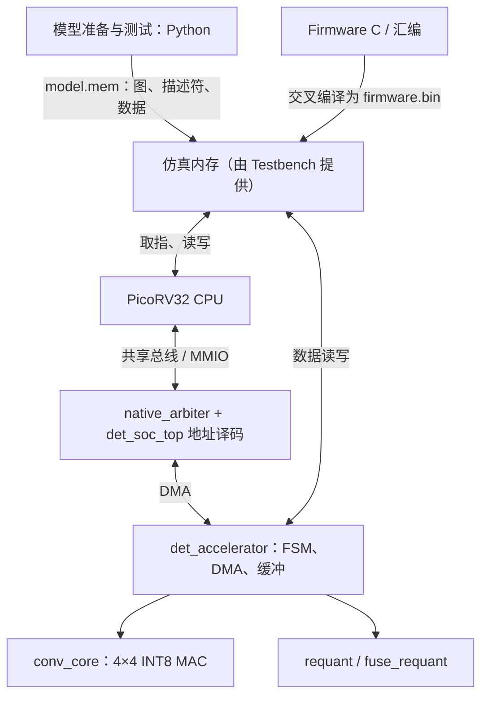

# 理解 ai-soc：从 YOLO 模型到 RISC-V AI 加速器的完整执行链

> **适用仓库**：[PimeGiano/ai-soc](https://github.com/PimeGiano/ai-soc)（`main` 分支，按 2026-11-07 可见源码整理）  
> **文档定位**：架构理解与代码阅读指南，非逐行 API 手册。先回答“为什么这样设计、不同部分如何连接”，再说明在哪里查具体实现。  
> **建议阅读方式**：第一次阅读重点看第 1、2、3、4、6、8、11 节；第二遍再看数据布局、量化、验证和性能。已有代码经验的读者可直接从第 4 节的完整调用链开始。

---

## 0. 阅读前，先抓住六个答案

1. **项目在做什么？** 构建一个能够运行 YOLOv3-tiny / YOLOv4-tiny 的、具有真实 PicoRV32 CPU 与专用 INT8 卷积加速器的 RTL 级异构 SoC，并研究**融合上采样、拼接和卷积**能否减少主存流量与执行周期。
2. **创新点是什么？** 不是“发明了卷积”或“把 MAC 做得特别大”，而是改变数据流：避免把完整的上采样张量和拼接张量先写到外部内存、再读回来；加速器直接从两路源特征图构造卷积需要的局部输入块。
3. **Python、Firmware、RTL 分别做什么？** Python 在主机上准备模型、量化参数、描述符、参考结果；Firmware 是 PicoRV32 执行的 RISC-V 机器码，负责逐层调度、驱动硬件和软件算子；RTL 描述 CPU、总线、DMA、卷积阵列及控制逻辑。
4. **三者怎样连接？** 通过 **`model.mem` → 模拟内存 ← `firmware.bin`**，然后由 CPU **MMIO** 发命令，加速器通过 **DMA** 访问相同的内存。最终测试平台读出结果，再由 Python 验证。
5. **4×4 INT8 是什么意思？** 输入、权重为 **INT8（8 位有符号整数）**；4×4 表示 **16 个并行 MAC**，每个 MAC 使用 **INT32 累加器**。INT8 是精度，4×4 是阵列规模，不能混为一谈。
6. **项目现在做到哪一步？** 已有可运行的 CPU+RTL 联合仿真、完整模型执行、逐层检查、融合前后性能对照；**没有**流片、FPGA 实测、DDR 控制器、真实 FPS/功耗、时序收敛，也**没有**实现双 bank X/W 缓冲。

一句话描述项目：**在一个可运行 RISC-V 固件的仿真 SoC 中，用专用卷积硬件执行神经网络的高密度乘加，并把多尺度特征融合时不必要的主存中间张量消除掉。**

## 1. 项目为什么存在：不是只追求更多乘法器

### 1.1 一个神经网络推理系统实际要做三件事

- **算**：执行卷积中的乘加运算（MAC：Multiply-Accumulate）。
- **存**：保存输入特征、权重、部分和、输出。
- **搬**：把数据从存储器送到计算单元，以及把结果写回。

提高乘法器数量只解决“算”的一部分；如果数据来不及供应，计算单元就会空闲。片上存储、复用和数据流设计是 AI 芯片的核心问题。

项目选择了 YOLOv3-tiny / YOLOv4-tiny 两个轻量目标检测网络作为验证对象：它们都有普通卷积、池化和检测头，也有多尺度特征连接，足以体现数据搬运问题；但这里的硬件并非支持所有神经网络的通用 NPU。

### 1.2 多尺度融合带来的额外搬运

YOLO 会把低分辨率特征图上采样，与高分辨率特征图按通道拼接，再做卷积。设：

- `L`：低分辨率特征；
- `H`：高分辨率特征；
- `U = Upsample2x(L)`；
- `C = Concat(U, H)`；
- `Y = Conv(C, W)`。

**普通物化路径 M**：

```text
主存中的 L ─→ CPU 上采样/重定标 ─→ 主存中的完整 U ─┐
                                                    ├─→ CPU 拼接 ─→ 主存中的完整 C
主存中的 H ────────────────────────────────────────┘                         │
                                                                                ↓
                                                                        加速器 Conv ─→ Y
```

**融合路径 F**：

```text
主存中的 L ─┐
            ├─→ 加速器：双源地址计算、必要的重定标、局部复制/散写
主存中的 H ─┘                                      ↓
                                            当前 Tile 的 X Buffer
                                                   ↓
                                              同一个 Conv 核 ─→ Y
```

两种路径在数值上应得到**完全相同的定点结果**，区别是数据的流动方式。F **不再在外部主存中物化完整的 U/C**；它仍会在片上 `xbuf` 中形成当前 Tile 的局部输入块。它没有把上采样和拼接的数学语义删掉。

这就是项目的主线。后面各模块都可以看作在服务这条主线。

### 1.3 什么才是这个项目的有效结论？

- **功能正确**：同样的输入与定点权重，M/F 输出一致；另有独立参考逐字节验证。
- **结构确有区别**：F 不为 U/C 分配完整的主存中间张量。
- **效果可测量**：比较 M/F 的总线读写量与执行周期，说明在哪些子图有效、对整网影响有多大。
- **明确边界**：不能把一个 RTL 仿真工程说成已经制造和测过功耗的芯片。

## 2. 先把“三个执行世界”分开

这是初学者最容易混淆的地方。

| 世界 | 在哪里运行 | 主要文件 | 干什么 |
|---|---|---|---|
| **主机工具** | 你的 WSL / Linux 电脑 | `scripts/*.py`、Shell | 读取模型、量化、生成数据与参考结果，启动构建和校验 |
| **目标 SoC** | Verilator 模拟的电路 | `rtl/*.sv`、`third_party/picorv32.v` | CPU 取指、访问总线、DMA、MAC、量化、写回 |
| **目标机软件** | **目标 SoC 内的 PicoRV32** | `firmware/*.c`、`start.S` | 读取计算图、发出加速器命令、执行软件算子和后处理 |
| **仿真环境** | 主机上的 C++ 进程 | `tb/soc.cpp`、`tb/memory.hpp` | 给 RTL 提供时钟、复位和模拟内存，检查结果与统计事务 |

固件虽然**在主机上编译**，但编译产生的指令是在**被模拟的 PicoRV32** 上执行；`tb/soc.cpp` 不会直接调用固件里的 `main()`。

### 2.1 分别编译出什么？

```text
                 【在 WSL 主机上】
  data/yolov3-tiny.cfg + .weights + 图片
                    │
             Python 导出/量化
                    ↓
                model.mem ────────────────┐
                                           │
  firmware/*.c + start.S                   │
                    │                      │
              RISC-V 交叉编译             │
                    ↓                      │
               firmware.bin ───────────────┤
                                           ↓
  rtl/*.sv + PicoRV32.v ─→ Verilator ─→ Vdet_soc_top + C++ Testbench
                                              │
                         加载 model.mem 和 firmware.bin，复位并逐拍运行
                                              │
                                              ↓
                                       boxes.bin / 日志
                                              │
                                          Python 校验
```

这里至少有 **三种不同的二进制**：

- `model.mem`：**数据映像**，包含特征、权重、量化参数、描述符和计算图；不是 RISC-V 程序。
- `firmware.bin`：**RISC-V 机器指令映像**；不是在 WSL 直接执行的 x86 程序。
- `build/soc/Vdet_soc_top`：**主机可执行的仿真器程序**，内部模拟了 RTL 电路；不是芯片固件。

## 3. 把系统分成五层，就不会迷失在文件里



> 图按职责表达，省略了 CPU 到仲裁器、仲裁器到内存的部分具体连线；不是物理版图。

### 3.1 核心文件地图

| 文件 | 一句话职责 | 最值得寻找的入口 |
|---|---|---|
| [`rtl/det_soc_top.sv`](../rtl/det_soc_top.sv) | SoC 顶层；实例化 CPU、仲裁器、加速器，地址译码 | `picorv32`、`native_arbiter`、`reg_select` |
| [`rtl/native_arbiter.sv`](../rtl/native_arbiter.sv) | CPU 和 DMA 的双主设备共享总线仲裁 | `selected`、`locked`、`last_owner` |
| [`rtl/det_accelerator.sv`](../rtl/det_accelerator.sv) | 整个卷积加速器：描述符、取数、缓冲、状态机、写回 | `TILE_BEGIN`、`GATHER_A/B`、`MAC_STEP` |
| [`rtl/conv_core.sv`](../rtl/conv_core.sv) | 16 个 INT8 MAC，16 个 INT32 累加器 | `product`、`acc`、`step` |
| [`rtl/requant.sv`](../rtl/requant.sv) | INT32 到 INT8 的定点尺度转换 | `multiplier`、`shift`、`result` |
| [`rtl/fuse_requant.sv`](../rtl/fuse_requant.sv) | 融合时把两个输入分支变换到共同尺度 | `src_id`、`in_valid`、`out_valid` |
| [`rtl/spec.vh`](../rtl/spec.vh) | 硬件侧寄存器偏移和描述符字段索引 | `REG_*`、`D_*`、`F_*` |
| [`firmware/main.c`](../firmware/main.c) | 目标 CPU 逐个执行计算图操作 | `main`、`pool`、`materialize` |
| [`firmware/driver.c`](../firmware/driver.c) | CPU 通过 MMIO 启动卷积，并轮询完成 | `det_conv`、`MMIO`、`det_hash` |
| [`firmware/postprocess.c`](../firmware/postprocess.c) | YOLO 检测头解码、类别筛选和 NMS | `det_postprocess` |
| [`firmware/start.S`](../firmware/start.S) | 目标 CPU 复位后先执行的启动代码 | `_start`、`call main` |
| [`firmware/link.ld`](../firmware/link.ld) | 固件链接时的程序/数据布局 | `CODE`、`DATA`、`_stack_top` |
| [`scripts/export_model.py`](../scripts/export_model.py) | 把模型变成量化数据、图操作记录和卷积描述符 | `export`、`image.words(d)`、`op(...)` |
| [`scripts/memory.py`](../scripts/memory.py) | 给数据分配目标 SoC 地址，生成分段 `model.mem` | `Image.put`、`Image.write` |
| [`tb/soc.cpp`](../tb/soc.cpp) | 时钟、复位、内存握手、ROI 统计、结果提取 | `tick`、`mem.load`、`mem.compare` |
| [`tb/memory.hpp`](../tb/memory.hpp) | 64 KiB 程序区、64 MiB 数据区的仿真内存 | `Memory::read/write/load` |

推荐理解顺序不是文件的字母顺序，而是：**项目目标 → `run_model.sh` → `export_model.py` → `tb/soc.cpp` → `main.c` / `driver.c` → `det_soc_top.sv` → `det_accelerator.sv` → `conv_core.sv`**。

## 4. 真正沿着一次推理走完：Python → Firmware → RTL → Python

这是全篇最重要的一节。以以下命令为例：

```bash
bash scripts/run_model.sh yolov3-tiny F 0 0
```

参数分别是：模型、模式（F/M/B0）、额外随机访存等待上限、是否使用整网 ROI。命令对应 [`scripts/run_model.sh`](../scripts/run_model.sh)。

### 第一步：Python 读取模型、量化、生成参考答案

`export_model.py` 使用 `model.py` 读取 `.cfg` 和 `.weights`，将默认图片预处理为 **160×160、batch=1**，生成 INT8 特征图与权重，并由 `reference.py` 计算独立定点参考结果。

它为每层卷积准备一份 **32 个 32 位字（128 B）的主描述符**，包含：输入地址、权重地址、输出地址、量化参数地址、卷积核、步长、padding、Tile 参数等。

关键的三个 Python 变量：

```python
wa = alloc(qw)       # 把当前层 INT8 权重放入目标内存映像，得到目标地址
qa = alloc(q.astype("<i4")) # 把每通道量化参数放入映像，得到目标地址
da = image.words(d) # 把卷积描述符放入映像，得到它的目标地址
```

之后创建**计算图操作记录**：

```python
op(1, src, 0, addr, y.shape, desc=da, expected=y, layer=i)
```

操作 `type=1` 表示“这一条是卷积”；第 14 个字段 `desc` 指向卷积描述符。这里的 `da` 是**目标 SoC 内存地址**，不是 Python 对象指针。

> **不要混淆**：计算图操作记录告诉 CPU“执行哪种算子、去哪找任务参数”；卷积描述符告诉加速器“这一层卷积如何算”；权重和特征数据才是最终的计算对象。

### 第二步：Python 生成 `model.mem`

`scripts/memory.py` 的 `Image` 从 `0x01010000` 起为模型对象分配目标地址，并维护 `(地址, 字节内容)` 列表。

最后在固定地址 `0x01008000` 放入计算图头：

```python
image.parts.append((0x01008000, struct.pack("<16I", *header)))
image.write(out / "model.mem")
```

`model.mem` 是一种**分段内存映像**，不是把整个 64 MiB 数据内存依次写一遍：

```text
4 字节：段数
对于每段：
    4 字节：目标地址
    4 字节：段长度
    N 字节：这段的内容
```

需要强调：脚本虽然在主机上计算参考输出，但为目标 SoC 分配的输出位置是**待写入的缓冲**；并没有把整层参考结果直接预装进实际输出区后冒充 RTL 的结果。

### 第三步：Firmware 被编译为 PicoRV32 指令

`build_firmware.sh` 用 RISC-V 交叉编译器把 `start.S`、`main.c`、`driver.c` 和 `postprocess.c` 编译链接为 `firmware.elf`，再提取 `firmware.bin`。目标 ISA 是 **RV32IM**。

这里的两个文件角色不同：

- `firmware.elf`：含有用于链接、调试的 ELF 格式信息。
- `firmware.bin`：用于装入仿真程序区的机器码数据。

`firmware/start.S` 初始化全局指针、栈指针、清零 `.bss`，随后 `call main`。CPU 并不会在复位后自动理解 C 语言源文件。

### 第四步：Verilator 构建一个“主机可运行的 SoC 仿真器”

`build_soc.sh` 将 PicoRV32 Verilog、项目 `rtl/*.sv` 和 `tb/soc.cpp` 构建为：

```text
build/soc/Vdet_soc_top
```

运行时它接受以下参数：

```text
Vdet_soc_top model.mem firmware.bin checks.txt boxes.bin [delay] [whole]
```

在 `tb/soc.cpp` 中有真正的汇合点：

```cpp
Vdet_soc_top t;                         // Verilator RTL 模型
Memory mem;                             // 由 C++ 提供的仿真内存
mem.load(argv[1]);                      // 加载 Python 生成的 model.mem
firmware.read((char *)mem.code.data(), mem.code.size()); // 加载机器码
```

C++ 提供时钟、复位和内存访问响应。PicoRV32 的 `PROGADDR_RESET=0`，所以它会从模拟内存地址 0 取指，执行固件 `_start`，最终进入 `main()`。

**此处不是 C++ 直接调用 C 固件；是 RTL 中的 CPU 逐条执行已编译的 RISC-V 指令。**

### 第五步：CPU 从固定地址读取计算图

在 `firmware/main.c`：

```c
const uint32_t *h = (const uint32_t *)0x01008000u;
const uint32_t *ops = (const uint32_t *)h[2];

for (uint32_t i = 0; i < h[1]; i++) {
    const uint32_t *o = ops + i * 24;
    if (o[0] == 1)
        det_conv(o[14]);
    /* 其他类型由 CPU 软件执行 */
}
```

这里 `h[1]` 是操作数，`h[2]` 是操作数组地址；每条操作记录长 **24 个 32 位字（96 B）**；`o[14]` 是当前卷积描述符的目标地址。

### 第六步：Firmware 通过 MMIO 启动硬件

`driver.c`：

```c
#define MMIO(o) (*(volatile uint32_t *)(DET_BASE + (o)))

MMIO(DET_REG_DESC_ADDR) = desc;
det_fence();
MMIO(DET_REG_CTRL) = 1;
```

`DET_BASE=0x10000100`，`DESC_ADDR` 偏移是 `0x08`，`CTRL` 偏移是 `0x00`。

为了理解，我们**假设** Python 给某层卷积描述符分配地址 `0x01200000`（示例，实际运行由内存分配器决定）：

```text
CPU 执行写操作1：地址 0x10000108，数据 0x01200000
CPU 执行写操作2：地址 0x10000100，数据 0x00000001
```

CPU 执行对应的 `sw` 指令后，RTL 的 PicoRV32 会拉起 `mem_valid`、提供 `mem_addr`、`mem_wdata`、`mem_wstrb`。共享仲裁器转发请求；`det_soc_top` 根据地址选择加速器 MMIO；`det_accelerator` 识别 `REG_CTRL=1`，从 `IDLE` 转入 `DESC_REQ`。

**这就是一行 C 语句最终改变 RTL 状态机的全过程。**

### 第七步：加速器作为 DMA 主设备读取 Python 的数据

硬件状态机进入 `DESC_REQ`，通过 DMA 从示例地址 `0x01200000` 读取 128 B 描述符：

```verilog
read_at(desc_addr + 32'(di * 4), DESC_GOT);
```

读取后的值进入内部 `d[0:31]`，再用于读取 X/W、计算输出地址、检查形状和 Tile 容量。

数据传递顺序是：

```text
Python 生成的整数、数组
    ↓ 写成 model.mem 的内存片段
C++ Memory 内的数据
    ↓ RTL DMA 总线读事务
RTL 内部描述符 d[]、xbuf、wbuf
    ↓
conv_core MAC + 输出 requant
    ↓ RTL DMA 总线写事务
C++ Memory 内的结果区
```

大量输入和结果**不经 `reg_wdata/reg_rdata` 一项项传送**；MMIO 负责控制，DMA 负责数据。

### 第八步：CPU 等待完成、验证并做后处理

`driver.c` 使用轮询：

```c
do {
    s = MMIO(DET_REG_STATUS);
} while (s & 1); // BUSY bit
```

硬件写完输出后清 `busy`、置 `done`；CPU 才会执行下一层。当前项目 **没有使用加速器中断**。

整图结束后，固件计算逐层输出哈希、运行 YOLO 解码与 NMS，然后向仿真环境专用地址 `0x20000004` 写成功标记。`tb/soc.cpp` 收到后停止仿真，逐字节检查参考层输出、把检测框导出为 `boxes.bin`。最后 `scripts/check_boxes.py` 读取 `boxes.bin`，与 Python 的参考检测框比较。

**完整闭环：主机准备数据 → 固件控制硬件 → RTL 真正算出输出 → 主机核对结果。**

## 5. CPU、MMIO、DMA、内存究竟怎样互联？

### 5.1 PicoRV32 为什么需要和加速器一起存在？

CPU 擅长执行控制、分支以及多种异构操作。项目中的 CPU 负责图解释、池化、切片、部分物化操作、解码和 NMS。加速器专门处理普通卷积和支持的融合卷积。

同一个 `det_accelerator` 有两种总线身份：

- **MMIO 从设备**：接收 CPU 对 `CTRL/STATUS/DESC_ADDR` 等寄存器的读写。
- **DMA 主设备**：主动读内存中的输入与权重，主动写回输出。

### 5.2 顶层为什么需要 `native_arbiter`？

CPU 需要取指与读写数据；DMA 同样需要访问内存。它们共享一条外部总线。两者同时请求时，`native_arbiter` 选择一方，并在这笔事务未完成（`ready=0`）期间锁定选择；完成后双主竞争时轮流选择，避免任意切换尚未完成的请求。

协议核心是：**`valid` 表示请求有效，`ready` 表示该笔事务在当前时钟完成**。等待期间请求地址、数据、写使能必须保持稳定。

### 5.3 地址如何区分“内存”和“加速器寄存器”？

在 `det_soc_top.sv`：

```verilog
wire reg_select = sa[31:8] == 24'h100001;
assign mem_valid = sv && !reg_select;
```

加速器 MMIO 地址范围是 `0x10000100–0x100001FF`。命中该范围时访问加速器寄存器，否则请求向外部内存接口传递。

| 地址范围/点 | 用途 |
|---|---|
| `0x00000000–0x0000FFFF` | 64 KiB 指令/常量程序区 |
| `0x01000000–0x04FFFFFF` | 64 MiB 仿真数据主存 |
| `0x01008000` | 计算图头部固定地址 |
| `0x01010000` 起 | Python 动态分配模型数据、权重与描述符 |
| `0x04F00000–0x04FFFFFF` | 固件栈预留区，栈顶 `0x05000000` |
| `0x10000100–0x100001FF` | 加速器控制寄存器 CSR |
| `0x20000000/04/08` | 测试平台打印、退出、ROI 计量标记，不是物理 UART/DDR 外设 |

**关键区别**：64 MiB 主存由 C++ Testbench 实现，不是 `det_soc_top` 里已经设计出来的真实 DDR 控制器；24 KiB 本地 Scratch 则是加速器 RTL 内描述的 X/W/P/O 存储资源。

### 5.4 32 位总线为什么能传输 INT8？

总线按 32 位字访问，数据仍按字节地址存放。`wstrb=0000` 表示读，其他位逐字节控制写入。

例如读取地址 `0x01010002` 的 INT8：RTL 可以读取对齐后的 `0x01010000` 整个 32 位字，再根据地址低两位选择第 2 个字节。

为避免对同一个 32 位字的四个字节反复访问总线，`det_accelerator` 有一个**最近读取字的小缓存**，不是一般意义上的多行 CPU Cache。

当前输出 `WRITE_OUT` 每笔完成的写事务**只更新一个字节 lane**；将四个 INT8 合并成一次 32 位写，是可能的优化点而非已实现的特性。

## 6. 从卷积数学到 4×4 MAC：它到底在算什么？

### 6.1 卷积的一项输出

普通卷积的一个输出元素为：

\[
Y[y,x,o] = \sum_{k_y,k_x,c} X[yS+k_y-P,\;xS+k_x-P,\;c]\;W[o,k_y,k_x,c]+b_o
\]

为简化表达，上式用相同的 padding 符号；项目实际支持上下左右分别指定。输入采用 **NHWC**（空间位置在前、通道在后）；权重采用 **OHWI**（输出通道、核高、核宽、输入通道）。布局不同，地址公式也不同，不能混用。

令：

\[
M=H_{out}W_{out},\quad N=C_{out},\quad K=K_HK_WC_{in}
\]

就可把卷积看成一个隐式矩阵乘法：

\[
C_{M\times N}=A_{M\times K}B_{K\times N}
\]

`A` 的一行对应一个输出空间位置展开后的输入窗口，`B` 的一列对应一个输出通道的卷积权重。项目**直接计算索引以采集滑窗数据**，不在外部主存生成完整 `im2col` 矩阵。

### 6.2 4×4 阵列的行列分别代表什么？

非常重要：这里的 **4 行不是特征图的四行，4 列也不是特征图的四列**。

- MAC 阵列的第 `r` 行：第 `r` 个**输出空间位置**。
- MAC 阵列的第 `c` 列：第 `c` 个**输出通道**。

每个 `kpos` 取出四个激活值 `a0..a3` 和四个权重 `b0..b3`，完成一次外积：

\[
\begin{bmatrix}C_{00}&C_{01}&C_{02}&C_{03}\\C_{10}&C_{11}&C_{12}&C_{13}\\C_{20}&C_{21}&C_{22}&C_{23}\\C_{30}&C_{31}&C_{32}&C_{33}\end{bmatrix}
\leftarrow
C+
\begin{bmatrix}a_0\\a_1\\a_2\\a_3\end{bmatrix}
\begin{bmatrix}b_0&b_1&b_2&b_3\end{bmatrix}
\]

因此一次有效 `step` 执行 **16 次 MAC**，但仅计算 K 维中的一个位置。它不是“4×4 个卷积核同时算完”，更不是每个输出只需一次乘法。

### 6.3 `conv_core.sv` 真正实现了什么？

```verilog
for (genvar r = 0; r < 4; r++)
    for (genvar c = 0; c < 4; c++)
        assign product[r*4+c] =
            $signed(a_vector[r*8 +: 8]) *
            $signed(b_vector[c*8 +: 8]);
```

`genvar` 是**生成硬件的静态循环**，不是运行时让一个乘法器执行 16 次。这段代码在结构上展开为 16 个乘法计算。

`reg signed [31:0] acc[0:15]` 保存 16 个 INT32 部分和；`step` 时全部累加；`clear` 同步清零；`restore` 一次恢复一个 `acc[index]`；`result=acc[index]` 提供一次一个的结果输出。操作优先级为 **reset/clear > restore > step**。

INT8 乘 INT8 得到 16 位乘积，再做**符号扩展**加入 INT32 累加器。代码没有提供溢出饱和机制，数值安全依赖模型导出和必要的范围检查。

### 6.4 广播阵列和脉动阵列有什么区别？

你现在使用的是 **4×4 广播式、Output-Stationary（输出部分和驻留）** 阵列：`a_r` 送到该行四个 PE，`b_c` 送到该列四个 PE，16 个部分和留在本地寄存器。

典型二维脉动阵列则通过相邻 PE 之间的寄存器**逐拍传播** A/B 数据，需要输入错峰和填充/排空管理。脉动阵列也可以采用 Output-Stationary；“Output-Stationary”描述保持哪类数据不动，“Systolic”描述数据如何在 PE 间传播，不是相反的概念。

目前 4×4 很适合教学型完整 SoC，尺寸较小但并不代表 INT8 精度太小；更大阵列能提高峰值算力，也会增加端口、布线与缓存压力。在当前项目中，优先需要解决的是**供数速度与阵列利用率**，而不是盲目把 4×4 改为 16×16。

## 7. 为什么有了 16 个累加器，还需要 Tile 和四类 Buffer？

### 7.1 两级分块

完整一层可能有成千上万个输出，显然不能同时塞进 16 个 `acc`。项目采用：

1. **Tile**：处理 `TH × TW` 个输出空间位置、`TOC` 个输出通道，输入通道分块长 `TIC`。
2. **Microtile**：一个 4×4 MAC 对应 **4 个空间位置 × 4 个输出通道**，产生 16 个部分和。

典型候选参数：`TH=8, TW=8, TIC=16, TOC=16`。输出空间位置按行优先展平，再每次取连续的四个位置；它们不一定构成图像上 2×2 或 4×4 的小正方形。

对应循环概念是：

```text
for 输出 Tile 的 oy, ox:
  for 输出通道块 oc0:
    for 输入通道块 ic0:
      准备这一块的 X / W
      for 输出空间微块 m0（步长4）:
        for 输出通道微块 n0（步长4）:
          初始化或恢复16个部分和
          for kpos in [0, KH*KW*TIC):
            取4个 A、取4个 B、一次 4×4 MAC
          保存 P，或在最后输入通道块写 O
    最终输出块 DMA 写回
```

对于边缘不足 4 个元素的尾块，以零补齐无效 lane，不应把补零 MAC 算作有用工作。

### 7.2 X/W/P/O 缓冲各存什么？

| 缓冲 | 当前 RTL 容量 | 内容 | 为什么需要 |
|---|---:|---|---|
| X (`xbuf`) | 8 KiB | 当前输入 Tile | 不必每次 MAC 都重读外部输入 |
| W (`wbuf`) | 8 KiB | 当前权重 Tile | 多个输出空间位置复用同组权重 |
| P (`psum`) | 4 KiB | 尚未完成的 INT32 部分和 | 16 个 `acc` 装不下整个 Tile，跨输入通道块继续累加 |
| O (`obuf`) | 4 KiB | 已完成 Bias/激活/重新量化的 INT8 输出 | 汇总后再通过 DMA 输出 |
| **合计** | **24 KiB** | 单 bank Scratch | **40 KiB 是设计预算，不是已经实例化的容量** |

例如输出 Tile `8×8×16` 共有 1024 个输出元素，P 需要 `1024×4=4096 B`。而 `conv_core` 只有 16 个累加寄存器，即 64 B 的 INT32 值。两者职责不同。

### 7.3 输入/权重缓冲容量为什么不是简单的 TH×TW？

由于卷积窗口重叠，若输出 Tile 为 `TH×TW`、卷积核 `KH×KW`、步长 `SH×SW`，实际需要的输入区域为：

\[
X_H=(TH-1)SH+KH,\quad X_W=(TW-1)SW+KW
\]

在 `TH=TW=8`、`KH=KW=3`、`stride=1`、`TIC=16` 时：

- X：`10×10×16=1600 B`；
- W：`3×3×16×16=2304 B`；
- P：`8×8×16×4=4096 B`；
- O：`8×8×16=1024 B`。

即使输出只有 8×8，也需要一个 10×10 的输入视野。接近图像边界时 padding 用零处理，Tile 越界时需要缩小有效尺寸。

### 7.4 P 的恢复与保存到底为什么存在？

假设 `Cin=32`、`TIC=16`。一个输出的全部 K 项需要两块输入通道才能算完：

\[
Y=\underbrace{\sum_{c=0}^{15}X_cW_c}_{\text{第一块}}+\underbrace{\sum_{c=16}^{31}X_cW_c}_{\text{第二块}}
\]

处理第一块时，16 个 `acc` 从零开始；阶段结束后将它们写入 P。转到第二块时，同一个 Microtile 要先从 P **逐项恢复 16 个部分和**，再继续乘加；只有最后一个输入通道块结束，才加 Bias、选择激活与量化参数、输出到 O。

这说明 P 与 O 不可互换：**P 仍在 INT32 累加阶段，O 已是最终 INT8。**

## 8. `det_accelerator` 状态机：用一张流程表理解 900 行代码

不需要先逐行阅读全部 RTL。只要理解状态机如何把一个任务拆为几个阶段：

| 阶段 | 代表状态 | 在做什么 |
|---|---|---|
| 任务接收 | `DESC_REQ/GOT`、`FUSE_REQ/GOT`、`CHECK_DESC` | 读描述符，检查形状、地址与容量 |
| 参数检查 | `PARAM_REQ/GOT` | 检查每输出通道的定点量化参数 |
| Tile 建立 | `TILE_BEGIN` | 计算当前 Tile 尺寸、输入窗口和通道范围 |
| 输入准备 | `X_ZERO`、`SOURCE_BEGIN`、`SAMPLE_REQ/GOT`、`SCATTER` | 清零 X，按普通/融合路径填充输入 |
| 融合转换 | `CONVERT_IN/OUT` | 从对应源分支转换到统一量化尺度 |
| 权重准备 | `W_REQ/GOT` | 将当前权重块加载到 W |
| 微块准备 | `MICRO_BEGIN`、`P_READ/RESTORE` | 16 个累加器清零，或恢复之前的部分和 |
| 乘加 | `GATHER_A`、`GATHER_B`、`MAC_STEP`、`K_NEXT` | 遍历 K 维，每次计算 16 个乘积累加 |
| 收尾 | `P_SAVE` 或 `RESULT`、`RESULT_NEXT` | 暂存部分和，或 Bias/激活/量化进 O |
| 推进 | `MICRO_NEXT`、`IC_NEXT`、`WRITE_OUT`、`TILE_NEXT` | 推进微块、输入通道、写回和下一个 Tile |
| 公共 DMA 读取 | `READ_DISPATCH/READ_BUS` | 复用的一套读事务控制，含一个对齐字缓存 |

其中 `TILE_BEGIN`、`MICRO_BEGIN`、`GATHER_A/B`、`MAC_STEP`、`K_NEXT`、`P_SAVE/RESULT` 和 `WRITE_OUT` 是理解代码的骨架。

### 8.1 为什么明明有 16 个 MAC，却只有平均 1.6 MAC/cycle？

控制器在每个 `kpos` 需要：

| 状态 | 周期 | 工作 |
|---|---:|---|
| `GATHER_A` | 4 | 从 X 逐个采集 4 个 INT8 激活 |
| `GATHER_B` | 4 | 从 W 逐个采集 4 个 INT8 权重 |
| `MAC_STEP` | 1 | **16 个 MAC 同时执行** |
| `K_NEXT` | 1 | 推进 K 索引 |
| **合计** | **10** | 完成一个 K 位置 |

因此，就这个稳定的 K 循环而言：

\[
\text{平均 MAC 吞吐}=\frac{16}{10}=1.6\ \text{MAC/cycle}
\]

这是**计算内循环**的平均值，不是整网吞吐；还没有计入 X 清零、W 加载、DMA 等待、P 恢复、输出写回、CPU 调度等额外开销，也没有扣除尾块中无效 lane。

例如 `TH=TW=8, TIC=TOC=16, KH=KW=3`：

- 空间位置 `M=64`，输出通道 `N=16`；
- Microtile 个数 `(64/4)×(16/4)=64`；
- 每个 Microtile 的 K 长度 `3×3×16=144`；
- 执行总数 `64×144×16=147456 MAC`；
- K 循环周期 `64×144×10=92160`。

如果四个 A 和四个 B 能够**每个周期**稳定供应一次 `step`，相同的有效计算只需 `9216` 个 MAC 使能周期。把这个理想值当作上限对照很有用，但它**不是**已经实现的流水结构或整任务实际周期。

因此，当前最大的直观改进点之一是**供数与计算重叠**，而不是把 `4×4` 一律扩大。扩大阵列还必须同步解决输入端口、Buffer bank、部分和与输出带宽问题。

### 8.2 一次部分和恢复需要多少周期？

P 中的 INT32 被逐项读取：`P_READ → P_RESTORE`，每个累加器约两拍，16 个共 **32 拍**。因此小 K 或频繁切换输入通道块时，恢复开销可能更显著。

### 8.3 RTL 中的 `always`、`<=` 和 `genvar` 怎么理解？

- `always @(posedge clk)`：描述寄存器在时钟边沿如何更新。
- `<=`：非阻塞赋值，同一时钟边沿上的寄存器更新不能被当作前一条语句立刻生效。
- `always @*`、连续 `assign`：主要描述组合逻辑。
- `genvar`：**编译展开硬件**，不是时钟周期中的软件循环。
- FSM 从 `GATHER_B` 转到 `MAC_STEP` 后，`MAC_STEP` 对应的后续时钟边沿才使用已经装入的向量执行 MAC。

## 9. 多尺度融合的真实语义：不能只看“省掉 U、C”

### 9.1 一个最小的二维例子

假设低分辨率分支 `L` 是 `2×2×1`，高分辨率分支 `H` 是 `4×4×1`。

低分辨率某通道：

```text
L = [ a  b ]
    [ c  d ]
```

2 倍最近邻上采样后：

```text
U = [ a  a  b  b ]
    [ a  a  b  b ]
    [ c  c  d  d ]
    [ c  c  d  d ]
```

与 `H` 按通道拼接后形状为 `4×4×2`。如果 `ORDER=0`，逻辑位置 `(y,x)` 上的两个通道分别取 `U[y,x]`、`H[y,x]`；如果 `ORDER=1`，顺序相反。

**F 路径不需要先构建完整的 U、C**，而是用坐标映射：

\[
U[y,x,c]=L[\lfloor y/2\rfloor,\lfloor x/2\rfloor,c]
\]

从低分辨率源读一次像素后，`SCATTER` 可以把转换后的值放到当前 `xbuf` 的最多四个对应位置。对于更大模型，只处理当前需要的 Tile。

### 9.2 为什么还要输入重定标？

两路特征图虽然都使用 INT8，但它们可能对应**不同的浮点尺度**。例如一支的整数 20 代表真实值 0.2，另一支的整数 20 可能代表 0.8。直接把 INT8 字节拼起来，在数学上未必正确。

因此项目在融合路径中使用 `fuse_requant`，先按分支参数 `M0/S0` 或 `M1/S1` 把样本转换到共同尺度，再复制或放入局部 X 缓冲。M 路径的 CPU 物化也采用一致的舍入、饱和规则。

### 9.3 为什么融合模式比较容易出错？

必须同时保持以下语义：

- **空间坐标**：低分辨率分支除以 2（向下取整），高分辨率分支不变。
- **通道顺序**：`ORDER` 不同，低/高分支的逻辑通道偏移不同；权重 Cin 顺序必须与拼接后的逻辑通道一致。
- **TIC 跨分支边界**：一个输入通道块可能前一部分来自低分支、后一部分来自高分支。
- **padding 和尾块**：越界位置是零，不应该从主存随意读取。
- **定点语义**：转换、舍入、饱和的先后次序不能擅自改变。

这就是项目为什么特别强调 M 与 F **逐元素、逐字节一致**。F 并非放宽精度的近似优化，而是等价的数据流重组。

## 10. INT8、INT32、Requant、Hash：四个容易混淆的概念

### 10.1 INT8 是精度，不是阵列尺寸

项目的输入和权重为**有符号 INT8**，零点为 0；乘积是 16 位有符号值，累加与 Bias 处理主要使用 INT32，必要时借助 64 位中间值进行乘移和范围检查。

**4×4** 表示 16 个并行乘加位置；**INT8** 表示一个输入或权重样本占 8 bit。两者是独立的设计维度。

### 10.2 为什么卷积末尾需要 Requant？

卷积的整数部分和 `acc` 并不自动具有下一层 INT8 激活所需的尺度。对称量化可写成：

\[
x_{real}\approx S_xx_q,\quad w_{real}\approx S_ww_q
\]

因此累加结果对应的数值尺度是 `Sx×Sw`；下一层需要输出尺度 `Sy`。概念上要计算：

\[
y_q\approx \operatorname{clip}\Bigl(\operatorname{round}(acc\cdot S_xS_w/S_y),-127,127\Bigr)
\]

项目把比例预计算为整数乘数 `m` 和右移位数 `s`：

\[
y_q=\operatorname{clip}\Bigl(\operatorname{round}_{away}(value\cdot m/2^s),-127,127\Bigr)
\]

`requant.sv` 使用有符号 64 位乘积、中间绝对值、**半值远离零**舍入与饱和。它属于**真实推理计算**，不是验证代码。正负两组乘移参数还可表达 ReLU、LeakyReLU 的作用。

举例：`value=123, m=1, s=2`，结果是 `round(30.75)=31`；不是简单地对 123 截断到 INT8。

### 10.3 Hash 的作用完全不同

`firmware/driver.c` 的 `det_hash()` 使用 **32 位 FNV-1a**：依次读取输出张量的字节，计算摘要值；`main.c` 将它与 Python 准备的参考摘要比较，以便快速判断层输出是否可能有错。

- **Requant**：改变输出数值，正常推理必须执行相应操作。
- **Hash**：只读取输出进行验证，正常部署可以不做；它不影响卷积结果。

哈希相同不保证数学上的绝对相同（可能碰撞），因此 `tb/soc.cpp` 还有逐字节参考比较。整层输出的正确性不能只依靠“最后检测出一只狗”。

### 10.4 为什么现有 AP 不高，并不能直接归罪于 INT8？

项目为了缩短 RTL 仿真时间把输入缩小到 **160×160**，并不是模型常见的 416×416 配置。两种 Tiny 模型本身的性能、预处理、缩小分辨率和量化损失均会影响 AP。应分别比较同配置浮点与 INT8 AP，而不能直接拿原模型更高分辨率的公开 AP 当基线。

## 11. 如何评价结果：正确性、流量、周期、精度、面积不是同一个指标

### 11.1 三种执行路径

| 路径 | 含义 | 用途 |
|---|---|---|
| **B0** | 由 PicoRV32 用 C 程序执行普通卷积的纯 CPU 基线 | 测通用 CPU 的卷积成本；目前主要完成小图验证 |
| **M（Materialized）** | CPU 物化上采样/拼接，再交给**同一套**硬件卷积 | 测没有融合时的数据搬运与运行成本 |
| **F（Fused）** | DMA 双源取数、输入转换、局部展开，由**同一套**硬件卷积 | 测融合后的成本 |

最重要的可比性条件是：**M/F 使用相同的 MAC 阵列和大体相同的分块架构，不能把更强计算硬件的收益伪装成融合收益。** M/F 差异还包含输入尺度转换位置由 CPU 转向硬件，因此应结合等尺度隔离实验解释“消除物化”的纯粹贡献。

### 11.2 仓库当前的实测结果

以下来自 [`results/summary.md`](../results/summary.md) 中保存的测试记录，不是理论峰值。

| 指标 | YOLOv3-tiny | YOLOv4-tiny |
|---|---:|---:|
| 融合子图周期减少（M→F） | **15.27%** | **15.27%** |
| 融合子图数据总线字节减少 | **18.88%** | **18.88%** |
| 整网周期减少（M→F） | **2.81%** | **1.94%** |
| 浮点 AP（160×160） | 3.80% | 11.56% |
| INT8 AP（160×160） | 3.33% | 10.15% |

注意这些数字的统计边界：

- 融合子图总线流量包含 CPU_DATA 和 DMA **实际完成**的读写字节，不含 CPU_IFETCH；所报告减少值不是仅统计理想张量大小得到的数。
- 整网周期包括 CPU 算子、驱动、轮询与硬件网络执行，但不包括主机图片预处理和另外统计的解码/NMS。
- 量化 AP 的测试由**主机**使用不重叠的 100 张 COCO train2017 校准与 500 张 val2017 评价；不代表 500 张都执行了 RTL 全系统仿真。
- 默认图片的单次演示校准标记为 `demo-only`，不能冒充独立精度评测。
- 子图周期减少目标达到约 15%；**30% 数据流量降低的研究目标并未达到**。报告结果时应同时保留未达目标。

### 11.3 为什么子图快 15%，整网只有约 2%？

因为多尺度融合只是网络中的一部分。其他卷积、CPU 池化/route/解码、访存与调度等工作依然存在。这符合 **Amdahl 定律**：只加速一小部分程序，整网速度提升会被未加速部分限制。

例如如果某个优化对象占总执行时间 20%，即使它被加速 2 倍，整体理论加速也只是 `1/(0.8+0.2/2)=1.11` 倍，而不是 2 倍。该数字只是说明原理，**不是仓库实测值**。

### 11.4 三种时间也不同

- **仿真周期数**：PicoRV32/RTL 在仿真中经历的时钟周期，适合比较同一时序模型的 M/F。
- **主机墙钟时间**：Verilator C++ 程序在 WSL 上跑了多久，受电脑性能与仿真成本影响。
- **真实芯片执行时间**：只有明确实际工作频率与物理实现后才可计算；当前项目没有该实测值。

`timescale 1ns/1ps` 只是仿真时间单位，不证明电路能达到 1 GHz。当前 `results/synthesis.json` 是保留 memory cell 的 RTL 结构统计，**不是**完整门级面积、频率、功耗或已布局布线的 SRAM 宏统计。

## 12. 现在已经实现什么，尚未实现什么？

| 方面 | 当前状态 |
|---|---|
| PicoRV32 运行真实裸机 C 程序 | **已实现**，在 Verilator 中逐条执行 |
| YOLOv3-tiny / YOLOv4-tiny 完整图路径 | **已验证**指定输入与受支持算子 |
| 通用 INT8 卷积，1×1、3×3 等受限配置 | **已实现**，受描述符约束 |
| 2×最近邻上采样 + 通道拼接 + 卷积融合 | **已实现**指定形式的双源融合 |
| 输出 INT32→INT8 重新量化，输入分支尺度转换 | **已实现** |
| 4×4 广播式 MAC + 24 KiB 单 bank X/W/P/O | **已实现** |
| 两份 X/W bank、DMA/计算重叠 | **未实现**；40 KiB 是预算，不是实占 |
| AXI/DDR 控制器、真实 SRAM 宏、FPGA、芯片流片 | **未实现** |
| 通用 ONNX 图、任意模型、训练、深度可分离卷积/attention | **不支持**或不在当前范围 |
| 完整门级时序、真实频率、FPS、功耗 | **没有可依据的实测** |

> 特别注意：`docs/design.md` 包含目标、预算、可选扩展；是否已做完以 `docs/implementation.md`、RTL 与测试结果为准，不能把“规划中的双 bank”讲成现有功能。

## 13. 如何有目的地阅读代码，而不是一次看完所有文件？

### 路线 A：先把三个世界串起来（推荐先读）

1. [`scripts/run_model.sh`](../scripts/run_model.sh)：看实际运行入口和四个步骤。
2. [`scripts/export_model.py`](../scripts/export_model.py)：只追踪 `image.words(d)`、`op(...desc=da)`、生成图头与 `model.mem`。
3. [`tb/soc.cpp`](../tb/soc.cpp)：只看创建 RTL 模型、加载 `model.mem`/`firmware.bin`、驱动 `tick()`。
4. [`firmware/main.c`](../firmware/main.c)：只看图头读取和 `o[0]==1 → det_conv(o[14])`。
5. [`firmware/driver.c`](../firmware/driver.c)：只看 `det_conv()` 的两次 MMIO 写入和 `STATUS` 轮询。
6. [`rtl/det_soc_top.sv`](../rtl/det_soc_top.sv)：看 CPU 总线如何经仲裁与地址译码命中加速器。
7. [`rtl/det_accelerator.sv`](../rtl/det_accelerator.sv)：找到 `DESC_REQ`，确认硬件再通过 DMA 读取 Python 的描述符。

读完之后应能不看资料解释：**Python 的 `da` 为什么最终会变成 RTL 的 `desc_addr`。**

### 路线 B：理解数据如何被计算

1. [`rtl/conv_core.sv`](../rtl/conv_core.sv)：理解 4 空间位置 × 4 输出通道、一个 `kpos` 一次外积。
2. `det_accelerator.sv` 中 `TILE_BEGIN`、`MICRO_BEGIN`、`GATHER_A/B`、`MAC_STEP`、`K_NEXT`。
3. `P_READ/P_RESTORE/P_SAVE/RESULT`：理解为何需要 4 KiB P 和输出量化。
4. `SOURCE_BEGIN/SCATTER`：理解普通卷积与双源融合如何共用同一个计算核心。

读完之后应能解释：**为什么 4×4 MAC 不意味着一层卷积只有 4 个时钟周期，也不意味着持续 16 MAC/cycle。**

### 路线 C：理解证据与实验

1. [`scripts/reference.py`](../scripts/reference.py)：独立数值参考。
2. [`tb/soc.cpp`](../tb/soc.cpp)、[`tb/memory.hpp`](../tb/memory.hpp)：逐字节比较与 ROI 统计。
3. [`scripts/check_boxes.py`](../scripts/check_boxes.py)：最终框的比较。
4. [`results/summary.md`](../results/summary.md)：M/F 子图、整网、流量、AP。
5. [`docs/implementation.md`](implementation.md)：哪些结果证明功能，哪些属于设计边界。

读完之后应能解释：**如何证明 F 真正减少数据搬运而不是改变卷积结果；为什么仿真周期不能直接换算 FPS。**

## 14. 最少要掌握的概念与常见误解

| 术语或容易误解的说法 | 正确认识 |
|---|---|
| **RTL** | 用寄存器、组合逻辑与时序语义描述硬件；不是按顺序运行的普通软件 |
| **PE / MAC** | PE 是计算单元的组织概念，MAC 是乘加运算单元；本项目的核心有 16 个并行 MAC |
| **INT8** | 数值精度；不意味着只能处理 8 个数据或 8 个通道 |
| **4×4 阵列** | 4 空间位置 × 4 输出通道；不是特征图 4×4 区域 |
| **Output-Stationary** | 部分和保持在本地累加器；不等于一定是脉动阵列 |
| **DMA** | 由加速器主动访问共享内存；不表示它可以与 CPU 同时完成同一个总线端口的两笔事务 |
| **MMIO** | CPU 用普通读写指令访问特定地址，由顶层译码成外设寄存器请求 |
| **Descriptor** | 存在数据内存中的任务参数；与硬件的 CSR 地址不是一个东西 |
| **Tile / Microtile** | 大任务局部化；Tile 受 X/W/P/O 容量约束，Microtile 与 16 MAC 对应 |
| **P Buffer vs O Buffer** | P 是待继续累加的 INT32；O 是最终 INT8 输出 |
| **Requant** | 按尺度换算并舍入/饱和，是推理计算的一部分 |
| **Hash** | 用于快速验证输出内容，不参与网络的数值功能 |
| **M vs F** | 是否将完整上采样/拼接中间张量物化到主存；两者共享同一卷积硬件 |
| **Verilator** | 在主机上编译出 RTL 的周期级仿真程序；不自动证明 ASIC 时序、面积和功耗 |
| **`model.mem`** | 带目标地址的模型数据映像；不是 RISC-V 指令文件 |
| **`firmware.bin`** | RISC-V 裸机程序；不直接在 WSL 主机 CPU 上运行 |

## 15. 自测：十个问题能否不用看源码回答？

**Q1：本项目为什么不是“只是一个 CNN 加速器”？**  
因为它包含实际执行 Firmware 的 PicoRV32、共享互连、MMIO、DMA、专用加速器、软件算子、模型图调度和系统级验证，是一个 RTL 级异构 SoC。

**Q2：Python 在硬件推理时是否逐层向 RTL 发送 NumPy 数组？**  
不是。Python 预先把数据和图写进 `model.mem`；目标 CPU/RTL 通过模拟内存和 DMA 访问它们。

**Q3：为什么还需要 Firmware？**  
硬件加速器只会按描述符完成所支持的任务；CPU 固件要决定调用哪些算子、何时启动、何时等待、怎样处理非卷积操作和后处理。

**Q4：一行 `MMIO(DET_REG_CTRL)=1` 怎样让 RTL 动起来？**  
交叉编译为 RISC-V 写指令 → PicoRV32 发 `mem_*` 请求 → Arbiter → `det_soc_top` 译码 → 加速器 CSR 写入 → FSM 从 `IDLE` 进入 `DESC_REQ`。

**Q5：为什么不从 `reg_rdata` 返回所有卷积结果？**  
控制寄存器适合小量配置；大量数据使用 DMA 写到主存指定的 `D_DST`，CPU 下一层可以直接按地址使用结果。

**Q6：为什么同一个 MAC 阵列既能做普通卷积又能做融合卷积？**  
融合改变的是形成逻辑输入张量的方法，不改变点积本身；最终仍是 4 个激活 × 4 个权重的一次外积累加。

**Q7：什么情况下 P 里保存的内容还不能直接量化？**  
还有后续输入通道块需要参与累加时。只有最后一块结束后才加 Bias 并生成 O。

**Q8：16 个 MAC 为什么未必达到 16 MAC/cycle？**  
当前 GATHER A/B 各需四拍，再做一拍 MAC 和一拍 K 推进；供数、同步等待和其他阶段让阵列空闲。

**Q9：M/F 输出完全相同，为什么周期和流量会不同？**  
因为计算的数值语义一样，数据准备路径不同；F 省掉部分完整主存中间张量，但增加局部地址映射与转换逻辑。

**Q10：如何客观报告项目效果？**  
分别报告功能对拍、子图周期/流量、整网周期、主机精度与 RTL 验证范围；明确 24 KiB 真实 Scratch、未实现双 bank、无物理 FPS/功耗依据。

---

## 附录 A：运行与产物速查

在已经安装好工具链并取得所需模型权重的情况下：

```bash
# 小范围回归，适合先验证环境
bash scripts/run_all.sh quick

# 单个模型的融合路径，全系统 RTL 仿真
bash scripts/run_model.sh yolov3-tiny F 0 0

# 同一模型的物化路径
bash scripts/run_model.sh yolov3-tiny M 0 0

# 全套 M/F 模型及子图/整网等回归（耗时较长）
bash scripts/run_all.sh full

# 独立 COCO 主机精度评估，不等同于整批 RTL 仿真
bash scripts/run_all.sh accuracy
```

| 产物 | 意义 |
|---|---|
| `build/<model>_<mode>/model.mem` | 已分配目标地址的模型数据和图 |
| `build/<model>_<mode>/checks.txt` | 待逐字节核对的输出地址、大小及参考文件 |
| `build/<model>_<mode>/manifest.json` | 导出统计、各层地址与参考等信息 |
| `build/firmware.elf`、`build/firmware.bin` | PicoRV32 固件 |
| `build/soc/Vdet_soc_top` | 主机侧的 SoC 仿真程序 |
| `results/<model>_<mode>/boxes.bin` | RTL CPU 后处理输出的检测框 |
| `results/<model>_<mode>/subgraph.log`、`whole.log` | 指定 ROI 的仿真与周期日志 |
| `results/summary.md` | 汇总的正确性、精度与性能证据 |
| `results/synthesis.json` | RTL 级结构统计，不是 PPA 实测 |

## 附录 B：查找更准确或更细的资料

- [当前已实现功能与测量边界](implementation.md)：遇到设计文档与实际代码不一致时优先看它。
- [寄存器、数据格式和接口契约](interfaces.md)：想知道确切地址、字段、标志与错误码时查看。
- [总体设计动机与研究目标](design.md)：解释为什么研究多尺度融合、哪些是规划的性能目标。
- [架构图](architecture.mmd)：系统框图的 Mermaid 源文件。
- [当前结果汇总](../results/summary.md)：以测试日志为依据，而非估算。
- [`spec/registers.json`](../spec/registers.json) → [`scripts/gen_spec.py`](../scripts/gen_spec.py)：C 的 `firmware/spec.h` 与 RTL 的 `rtl/spec.vh` 如何由统一规范生成。

**最终应该形成的系统直觉**：先想清楚哪部分数据在外部内存、哪部分留在片上、谁决定下一步、谁发起总线事务、何时真正发生 MAC、如何确保数值一致、什么指标能够支持性能结论。掌握这几个问题，理解这个项目就不再依赖逐行记忆代码。
